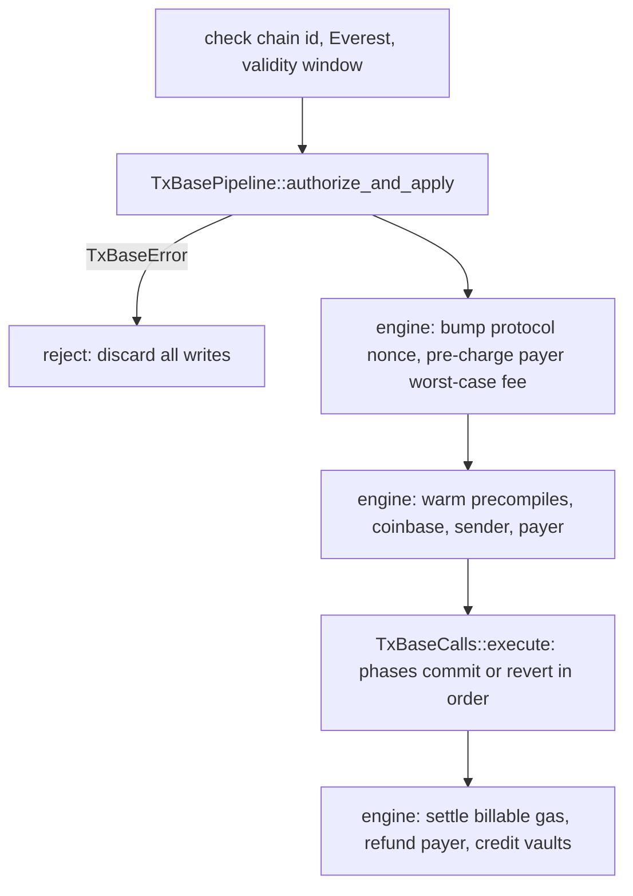

# base-execution-base-tx

Native Base transaction validation helpers.

The transaction type itself (`AA_TX_TYPE`, `0x79`), with its gas schedule, nonces and payer
modes, is specified as EIP-8430. Base calls it Base transactions.

This crate owns the reusable Base transaction validation pipeline:

- transaction sender and payer authorization with the native secp256k1
  authenticator (`ResolvedSender`, `TransactionAuthorizer`),
- the delegation account change (`DelegationEffect`),
- 2D nonce validation (`NonceValidator`), and
- intrinsic gas accounting and fee/balance validation (`IntrinsicGas`,
  `TxBaseGasSchedule`, `FeeCheck`), and
- the engine-neutral execution pipeline shared by the revm (`base-common-evm`) and EVM2
  (`base-common-evm2`) engines (`TxBasePipeline`, `TxBaseCalls`).

## Validation Layers

- **Transaction auth** recovers the sender and payer from their secp256k1
  signatures. A recovered (EOA) sender carries a bare 65-byte signature; a
  named sender or payer carries `K1_AUTHENTICATOR || r || s || v` and must
  recover to the named address. In open payer mode the payer is whoever the
  bare `payer_auth` signature recovers to. No other authenticator is accepted,
  and authorization reads no state.
- **Delegation** allows at most one account change, a delegation, which sets or
  clears the sender's EIP-7702-style delegation indicator. It only replaces
  empty code or an existing indicator, never deployed contract code.
- **Nonce validation** checks protocol, 2D-channel, and nonce-free replay state,
  and requires a transaction carrying a delegation to use the protocol nonce.
- **Gas and fees** compute the Base transaction intrinsic gas and validate the fee caps
  and the payer's balance (see below).

`TransactionAuthorizer` composes the sender and payer signatures with the
delegation into one verdict, shared by mempool admission and block inclusion;
nonce, gas, and fee/balance checks remain separate stages.

## Intrinsic gas

`IntrinsicGas::compute` returns the per-component breakdown from the Base transaction
formula:

```text
intrinsic_gas = AA_BASE_COST + tx_payload_cost + nonce_key_cost + value_transfer_cost
              + account_changes_cost + sender_auth_cost
              + first_call_cost + sender_access_cost + payer_auth_cost
```

The pricing follows the [EIP-2780](https://eips.ethereum.org/EIPS/eip-2780)
resource-based intrinsic gas: a self-paid k1 transaction pays EIP-2780's
amount for the same transaction plus its 5,100 k1 authentication cost.

| Component | Source |
|---|---|
| `base` | `AA_BASE_COST` (12,000): EIP-2780's `TX_BASE_COST`, covering one account access, one nonce write and one balance write in whichever accounts they land |
| `payload` | EIP-2028 data-availability cost (16/non-zero, 4/zero byte) over the RLP of `account_changes`, `calls` and `metadata` — the *standard* rate, subject to the EIP-7623 calldata floor below. The envelope (nonces, fees, `gas_limit`, validity window) is not metered, as in EIP-2780 |
| `payload_floor` | EIP-7623 calldata floor over the same bytes: `TX_TOTAL_COST_FLOOR_PER_TOKEN` (10) per payload token instead of the standard 4, so a data-heavy transaction cannot post data availability more cheaply than a standard EIP-7623 transaction on the same chain (always `>= payload`) |
| `first_call` | `2,600` cold account access for the first call's target (the first call of the first non-empty phase), as EIP-2780 charges `tx.to`; `0` when `calls` is empty or the target is the sender |
| `sender_account` | `2,600` cold account access for the sender's account when `payer` is set and differs from the sender (always in open payer mode, whose payer is only known from `payer_auth`). The base's one account access goes to the payer, and every transaction reads the sender's account nonce, so this is the second account; `0` for self-pay, with `payer` empty or equal to the sender |
| `nonce_key` | protocol nonce (`nonce_key == 0`) `0`, even on first use: it is the account nonce, bumped without touching the nonce manager and covered by `AA_BASE_COST` as a legacy transaction's base cost covers its nonce; nonce-free `13,000`; otherwise `22,100` when `nonce_sequence == 0` (the key's first use, since a sequenced key's current nonce must equal `nonce_sequence`) and `5,000` after (a cold SLOAD plus an SSTORE set or reset) |
| `value_transfer` | `6,000` per call with `value > 0` and `to != sender` |
| `account_changes` | the delegation entry's `4,600` indicator deposit; `0` without one |
| `sender_auth` / `payer_auth` | `5,100`: the `3,000` secp256k1 recovery plus one cold `2,100` state read; `payer_auth` is `0` for self-pay. A signature's bytes are covered by this cost and are not metered as payload. `payer_auth_cost` is the exact amount used for the payer's pre-charge, the EIP-7825 cap, the block gas reservation and settlement |

A value-bearing call to an account that does not exist also pays `25,000` for
account creation when it runs, since existence is only known at dispatch.
Dispatching a call also pays EIP-2929 account access gas for its target, as a
`CALL` would: `2,600` when the target is cold and `100` when it is warm. The
first call's target is already paid by `first_call`, so it pays nothing here. When
the target is an EIP-7702 delegated account, the call pays the same again for
the delegation target: `2,600` when it is cold and `100` when it is warm. The
precompiles, the coinbase, the sender, the payer, and every account the
pre-call pipeline touched start warm, and a repeated target pays the cold cost
once and the warm cost after. A call that halts
exceptionally (anything but `REVERT`) consumes all of the call gas left in the
pool, as any EVM frame does.

`sender_intrinsic` excludes `payer_auth` (payer authentication is metered on top
of `gas_limit`), so `execution_gas_available(gas_limit) = gas_limit -
sender_intrinsic`.

### EIP-7623 calldata floor

Following [EIP-7623](https://eips.ethereum.org/EIPS/eip-7623), the sender's
metered gas is floored so a transaction that posts many bytes relative to its
execution cannot drive the maximum block size back up. A Base transaction has
no single `data` field, so the floor is evaluated over the metered payload. As
in EIP-2780, one floor covers the whole transaction, and its base keeps the
base, authentication, account access and value charges while dropping the
state-dependent ones (`nonce_key`, `account_changes`):

```text
sender_floor = base + sender_auth + first_call + sender_account + value_transfer
             + payload_floor
metered_gas  = max(sender_intrinsic + execution_gas_used, sender_floor)
             + payer_auth_cost
```

A `gas_limit` below either `sender_floor` or `sender_intrinsic` is rejected at
mempool acceptance and at inclusion. The payer pays only `payer_auth_cost`
and has no separate floor. From Everest, gas-limit billing settles the whole reservation
instead: `gas_limit + payer_auth_cost`, with no refund (see
[`docs/guides/GAS_LIMIT_BILLING.md`](../../../docs/guides/GAS_LIMIT_BILLING.md)).
The `10`-per-token rate is normative structure: an L2-profile
chain may reprice `TX_TOTAL_COST_FLOOR_PER_TOKEN` but must not set it below the
standard `4` or drop the floor.

### Authenticator execution gas

The only authenticator is native secp256k1 recovery (the `K1_AUTHENTICATOR`
sentinel, or a bare signature on the EOA path). `TxBaseGasSchedule` prices its
execution at `3,000`, the `ECRECOVER` precompile cost.

The Base transaction gas schedule is a recommendation at the current point in time;
chains may implement a different schedule. A drift tripwire test pins the EVM
gas primitives to revm's canonical constants so an upstream repricing is
caught here rather than silently diverging.

## Fees and balance

`FeeCheck` validates the EIP-1559 fee caps against the block base fee and bounds
the payer's worst-case ETH debit at `(gas_limit + payer_auth_cost) ·
max_fee_per_gas` — `payer_auth_cost` is added because payer authentication is
charged on top of `gas_limit`. For self-pay the payer is the sender and
`payer_auth_cost` is `0`. `validate_gas_and_tip` extends that check with a
declared coinbase tip: self-pay must cover gas and tip from one balance, while
sponsored payment requires the payer to cover gas and the sender to cover the
tip.

The gas and fee layer is pure accounting: it reads no state and runs no EVM.
Intrinsic gas depends only on the signed transaction and its resolved sender,
so the pool, the builder and execution derive the same value. It does not
advance nonces, debit balances, or execute calls; the access costs of the
dispatched calls are charged by the execution metering layer.

## Engine-neutral execution pipeline

Both execution engines run a Base transaction through the same code; each engine only
supplies its journal (as a gas-free `StorageCtx` provider), its call frames
(`TxBaseCallHost`), and its fee routing.



- `authorize_and_apply` authorizes the sender/payer and account changes, installs created code
  and delegations, validates and advances the 2D nonce (or records the nonce-free replay hash),
  charges the Base transaction intrinsic schedule (a pure function of the signed transaction and its
  sender), enforces the EIP-7825 cap, checks the fee caps and the payer balance (`TxBaseError::PayerCannotPay`), and publishes the `TxContext`.
- `TxBaseCalls::execute` runs each phase under a checkpoint. A reverted or policy-blocked call
  reverts its phase and skips every later phase; the gas already spent is still charged and the
  transaction is included. `committed_phases` is the receipt's `committedPhases`.
- `TxBaseOutcome::billable_gas` is the settled gas: sender-intrinsic plus call gas, less the
  EIP-3529-capped signed refund, raised to the sender's EIP-7623 floor, plus payer
  authentication. The first call's target access is already in intrinsic gas, so the call
  loop charges only its delegation target.
- Simulation (`eth_call` / `eth_estimateGas`) uses `TxBasePipeline::simulate_resolve` (no
  signature verification, no nonce, no fee settlement) and, for estimation,
  `TxBaseCalls::search_estimate_pool` to find the minimum call pool at which the calls succeed.
  All simulated state is reverted.
