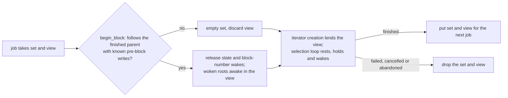

# `base-execution-payload-builder`

Payload builder for Base.

## Overview

Implements Base payload building and validation for the Base execution node. The
`BasePayloadBuilder` assembles new execution payloads from transaction pool contents and
`BasePayloadBuilderAttributes` received from the consensus layer. `BaseExecutionPayloadValidator`
verifies
built payloads against consensus rules. Also provides data availability configuration via
`BaseDAConfig` for fee calculation.

### Resting validity transactions across builds

With `RestingPredicateMode::Enforce`, a validity transaction whose predicate a build found
unsatisfied rests in `RestingPredicates` until a commit, pre-block write or new block can change
it. `RestingPredicateStore` hands the set from one finished block to the next job, for the
native builder after Denim and for Flashblocks. A failed, cancelled or abandoned job never puts
the set back, so the next job starts empty. A set finished on another parent, or carried without
known pre-block writes, is emptied. `Off` tracks nothing and `Shadow` evaluates every
transaction.

A member the pool iterators do not hold dormant stays in the set only while builds keep yielding
or holding it: the unseen sweep drops members no build saw for `RESTING_UNSEEN_RETAINED_BLOCKS`
blocks.

`RestingPredicates` also owns the lineage's `SelectionView` (see the `base-execution-txpool`
README), so `take`, `put`, a reset and an abandoned job treat the view like the members. A root
the hold held at iterator creation becomes dormant: later iterators skip it without asking, and
the unseen sweep stops visiting its member. It leaves the set when iterator creation reports
that the pool removed, replaced, mined or expired it, applied after the pool guards are
released. A commit or block-start release wakes it and removes the member as before; a dormant
root whose lane changed rejoins the unseen sweep as seen in the current block, unless the same
creation holds it again: the final state wins. A dormant member whose whole `ValidityConditions`
expire at the block being built is woken at block start, so iterator creation asks about it and the
builder classifies it expired; no other dormant member is visited. The deadline follows the
conditions the latest hold saw, so the same hash re-admitted with an earlier or later block bound
is woken at its new deadline. Deadline bookkeeping is bounded by the dormant members: removing,
re-resting or waking a member drops its entry, and a set whose members all left keeps none.
Flashblock-index predicates never rest.



## Usage

Add the dependency to your `Cargo.toml`:

```toml
[dependencies]
base-execution-payload-builder = { workspace = true }
```

```rust,ignore
use base_execution_payload_builder::BasePayloadBuilder;

let builder = BasePayloadBuilder::new(evm_config, payload_validator);
let payload = builder.build_payload(attrs, best_payload)?;
```

## License

Licensed under the [MIT License](https://github.com/base/base/blob/main/LICENSE).
