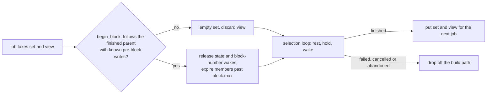

# `base-execution-payload-builder`

Payload builder for Base.

## Overview

Implements Base payload building and validation for the Base execution node. The
`BasePayloadBuilder` assembles new execution payloads from transaction pool contents and
`BasePayloadBuilderAttributes` received from the consensus layer. `BaseExecutionPayloadValidator`
verifies
built payloads against consensus rules. Also provides data availability configuration via
`BaseDAConfig` for fee calculation.

### Resting validity transactions across builds

With `RestingPredicateMode::Enforce`, a validity transaction whose predicate a build found
unsatisfied rests in `RestingPredicates` until a commit, pre-block write or new block can change
it. `RestingPredicateStore` hands the set from one finished block to the next job, for the
native builder after Denim and for Flashblocks. A failed, cancelled or abandoned job never puts
the set back, so the next job starts empty. A set finished on another parent, or carried without
known pre-block writes, is emptied. `Off` tracks nothing and `Shadow` evaluates every
transaction.

Today a member stays in the set only while builds keep yielding or holding it: the unseen sweep
drops members no build saw for `RESTING_UNSEEN_RETAINED_BLOCKS` blocks.

Proposed, not implemented: `RestingPredicates` will own the job's `SelectionView` (see the
`base-execution-txpool` README). A member dormant in that view is not visited by builds, so it
must not age out of the unseen sweep. It leaves the set when a view sync returns its insertion
identity as removed, replaced or mined; the builder applies those removals after the pool guards
are released. It also leaves when its whole `ValidityConditions`, kept from when it rested or
from the first sync that sees it, expire at flashblock index 0: at once for a bound below zero,
from block `block.max + 1` otherwise, never when `block.max` is at least `u64::MAX`.
Flashblock-index predicates never rest. Members that are not dormant keep the unseen sweep.
The view is taken, carried and dropped together with the set: `take`, `put` and an abandoned
job do the same to both, and a reset of the set discards the view.



## Usage

Add the dependency to your `Cargo.toml`:

```toml
[dependencies]
base-execution-payload-builder = { workspace = true }
```

```rust,ignore
use base_execution_payload_builder::BasePayloadBuilder;

let builder = BasePayloadBuilder::new(evm_config, payload_validator);
let payload = builder.build_payload(attrs, best_payload)?;
```

## License

Licensed under the [MIT License](https://github.com/base/base/blob/main/LICENSE).
