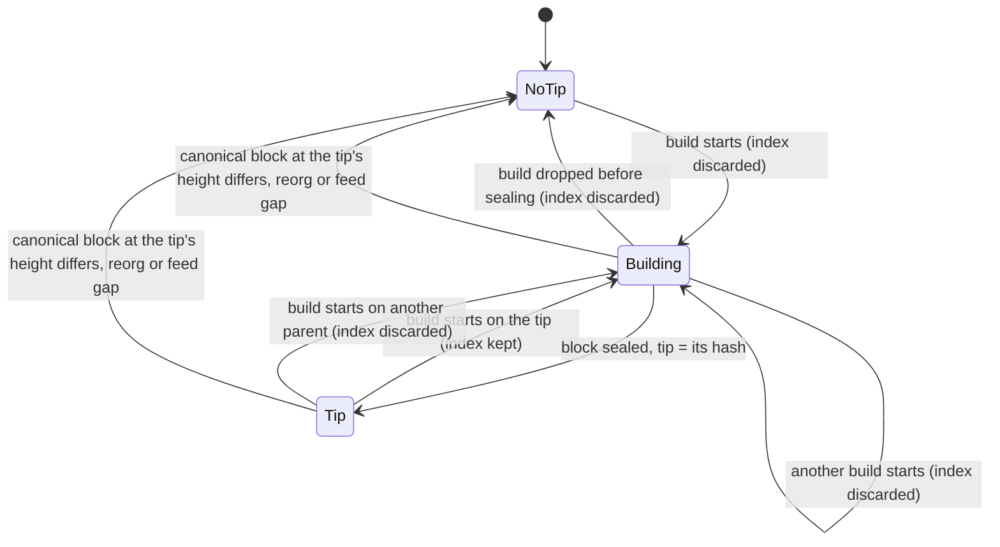

# `base-execution-txpool`

Transaction pool for Base.

## Overview

Extends Reth's transaction pool with Base-specific validation and ordering for the Base node.
`BaseTransactionValidator` enforces L1 data fee checks and Base-specific validity rules.
`BaseOrdering` and `TimestampOrdering` provide customizable transaction prioritization strategies.
Also includes a `BuilderApiImpl` for builder-specific pool management.

### Pluggable builder wire format

`ValidatedTransaction<E>` is the payload of `base_insertValidatedTransaction`, the endpoint mempool
nodes use to forward transactions to a builder. `E` carries additional wire fields and defaults to
`NoExtensions`, which encodes to exactly the same bytes as a struct without the field at all — so
the default is wire-compatible in both directions with peers that predate the parameter.

Downstream node builds substitute their own payload by implementing
`ValidatedTransactionExtensions<T>`, then registering the generic monomorphizations:

```rust,ignore
use base_execution_txpool::{
    BuilderApiImpl, BuilderApiServer, DEFAULT_MAX_VALIDITY_PREDICATES, ExtensionError,
    ValidatedTransactionExtensions,
};

#[derive(Debug, Clone, Default, serde::Serialize, serde::Deserialize)]
struct MyExtensions {
    #[serde(skip_serializing_if = "Option::is_none", default)]
    my_field: Option<u64>,
}

impl ValidatedTransactionExtensions<MyPooledTx> for MyExtensions {
    fn extract(tx: &ValidPoolTransaction<MyPooledTx>) -> Self { /* ... */ }
    fn apply(self, tx: MyPooledTx) -> Result<MyPooledTx, ExtensionError> { /* ... */ }
}

// Builder (ingress) side, in place of the stock `BuilderApiExtension`:
let api = BuilderApiImpl::<_, MyExtensions>::with_extensions(pool, true, DEFAULT_MAX_VALIDITY_PREDICATES);
modules.merge_configured(api.into_rpc())?;

// Mempool (egress) forwarding is provided by `base-tx-forwarding`.
```

Extension payloads must serialize as a JSON map (a braced struct, not a unit struct) and must avoid
`u128`/`i128` fields, which `serde_json` cannot represent through `#[serde(flatten)]`.

### Signed validity predicates

`TransactionValidity` carries off-chain predicates separately from the signed Ethereum
transaction. The transaction signature alone does **not** authorize those predicates.
Anyone holding the raw transaction can otherwise add a state predicate that delays
inclusion until their front-run has changed a pool's reserves. This can aid a sandwich
within the user's on-chain slippage limit; it does not change their signed calldata.

Use the shared `--validity-signature-mode off|verify-if-present|required` option
on forwarding ingress nodes and builders. It defaults to `off`: unsigned and signed
predicates are accepted without signature verification. Supplied signatures, even invalid
ones, are preserved for forwarding; malformed wire encodings and invalid predicate
parameters are still rejected. On builders the mode covers both
`base_sendRawTransactionValidity` and `base_insertValidatedTransaction`.

In `off` mode, nodes accept signed clients during rollout, but do not authenticate them.
Deploy `verify-if-present` to **every** ingress and builder so raw ingress verifies supplied signatures
while continuing to accept unsigned predicates. Migrate wallets and load clients to
signing, observe signed/unsigned admission counters, then switch the fleet to `required`.
At raw ingress, `required` rejects any non-empty predicate batch without valid sender
authorization. Builder insertion checks signature presence only and trusts the forwarder
to have verified it. Plain transactions need no extra signature.
Query nodes proxy sidecars unchanged and leave policy to the upstream sequencer.

**Off and optional verification modes are compatibility stages, not sandwich protection.**
As long as unsigned predicates are accepted, an intermediary can remove a
signature and submit different unsigned predicates. Do not claim protection
until **every forwarding ingress node** and each builder's raw ingress runs `required`,
each builder's insert policy requires signatures, and `base_insertValidatedTransaction`
is reachable only by trusted forwarders. A `required` builder alone is not protection:
an `off` forwarder can pass through a dummy signature and modified predicates, which
the builder's presence-only check will accept. Mixed-mode deployments are rollout
stages, not an authorization guarantee.

#### Wallet signing contract

Sign the EIP-712 digest returned by `ValidityAuthorization::signing_hash` using
`eth_signTypedData_v4` (not `personal_sign`). Submit the signature as
`validity_signature` alongside `validity` in the RPC options or builder payload.
It uses Alloy's signature JSON object (`r`, `s`, and `yParity` hex quantities).
The domain is `{ name: "Base Transaction Validity", version: "1", chainId }`;
`chainId` is the transaction's chain ID. There is no verifying contract.

```text
ValidityPredicate(uint8 kind,uint8 operator,address account,uint256 slot,uint256 mask,uint256 value)
ValidityAuthorization(bytes32 transactionHash,ValidityPredicate[] validity)
```

`transactionHash` hashes the complete signed EIP-2718 transaction envelope.
`kind` is balance = 0, storage = 1, block number = 2, flashblock index = 3, nonce = 4.
`operator` is `<` = 0, `<=` = 1, `=` = 2, `!=` = 3, `>` = 4, `>=` = 5.
Balance and nonce predicates use `account`; storage uses `account`, `slot`, and `mask`.
Nonce predicates read the account's protocol nonce, not an EIP-8130 channel nonce.
Unused fields are zero; omitted storage masks become `U256::MAX`.
`ValidityPredicateKind` and `ValidityOperator` define these explicit wire IDs.
All fields participate in each predicate's EIP-712 struct hash. Sort the typed
predicates by their struct hashes in ascending byte order before signing;
`ValidityAuthorization::canonical_predicates` builds this wallet-facing array.
Retain duplicates. Conjunction permutations produce the same digest; adding,
removing, or changing a predicate changes it. Evaluation uses its independent
cheap-first ordering and does not affect the signing contract.

Raw ingress reuses the recovered envelope sender to verify sidecar signatures
and rejects high-s signatures. Only sender-address secp256k1
authorization is supported; contract wallets or EIP-8130 actors without that
key cannot use signed sidecars. Deposits and unprotected legacy transactions
have no chain-bound signing domain and cannot authorize signed predicates.
Shadow-only predicate injection is incompatible with signature enforcement.
Predicates remain builder-side metadata, not on-chain consensus rules: a holder
can still strip the entire sidecar and submit the underlying plain transaction.
This feature prevents unauthorized predicate attachment, not all sandwich attacks.

`ValidityAuthorization::validate_recovered` reuses the sender already recovered at raw
ingress, including the builder's own `base_sendRawTransactionValidity` endpoint.
`base_insertValidatedTransaction` trusts forwarding mempool nodes to verify signatures
and only checks the local mode against signature presence. It does not recover either
the envelope sender or the sidecar signer again; restrict this endpoint to trusted forwarders.
Generic extension attachment does not take a validity-specific mode or enforce signature policy.
`with_validity(TransactionValidity)` attaches the sidecar without signature verification.
Raw ingress calls `validate_recovered` before attachment; the trusted builder insert
path attaches directly, then checks the local signature-presence policy.

`txpool.validity_signature.rejected{site,reason}` records bounded rejection reasons
at `ingress` and `builder`, independently of generic extension errors.
`txpool.validity_signature.accepted{site,signature}` separates signed and unsigned
sidecars to help operators assess migration readiness. RPC signature errors carry
the same stable rejection reason in their `data` field.

### Validity pool

`BaseTransactionPool` keeps three stores behind one `TransactionPool` surface:
the reth `Pool` for standard transactions, the EIP-8130 sidecar for finite
2D-nonce channels and nonce-free transactions, and a validity pool for every
transaction that carries validity predicates (conditional transactions), whatever
its envelope type. Validity transactions rest in the pool until a predicate on hot
state flips or their block deadline passes, so the validity pool has
its own count, size and per-sender caps and evicts only among validity
transactions. A burst of conditional transactions therefore cannot push standard
user transactions out of reth's pending subpool, and reth's own eviction cannot
drop resting validity transactions.

EIP-7702 delegation and validity predicates do not mix. The validator rejects a
transaction with validity predicates that is an EIP-7702 transaction or comes
from a delegated sender, and a state diff that changes an account's code drops
that account's validity transactions. The validity pool therefore never needs
reth's in-flight limits for delegated accounts and pending authorizations, which
apply only inside reth.

`PoolStore::of` picks the store. A nonce slot `(sender, nonce key, nonce)`, or a
nonce-free replay id, is held by at most one store at a time: a newcomer bound for
another store replaces the incumbent under the usual price-bump rule and the
incumbent's listeners see `Replaced`. Account semantics span the stores: a
validity transaction right behind reth's or the sidecar's pending run is pending
(`LaneCursor::next_nonce` follows that run), while a standard transaction behind a
resting validity transaction stays queued in reth until the nonce gap closes.
`best_transactions` merges the three stores by priority but never yields a
sender's nonce `n + 1` before `n`: a validity head continuing a standard run waits
until the merge has yielded the transaction before it, and standard transactions
queued right behind a validity run are released by the merge once that run has
been yielded, so a predicate-delayed transaction does not keep its descendants out
of the same block. The lanes that straddle stores are indexed incrementally
(`TwoDNoncePool::lanes_ahead_of_state`, `shared_lanes_pending_end`), so building
the iterator costs those lanes plus each store's own snapshot, not the pool sizes;
`benches/best_transactions.rs` measures it on a large pool.

Capacity defaults to reth's pending subpool limit (`--txpool.pending-max-count`,
`--txpool.pending-max-size`, `--txpool.max-account-slots`) and is overridable with
`--rollup.validity-pool-max-count`, `--rollup.validity-pool-max-size` (megabytes)
and `--rollup.validity-pool-max-account-slots`; see `ValidityPoolLimits`.
Occupancy is published as `txpool.validity.pool_transactions` and
`txpool.validity.pool_bytes`, evictions as `txpool.validity.evicted`, and
replacements that crossed a store boundary as
`txpool.validity.cross_store_replaced{direction}`.

### Dormant validity transactions

Validity transactions can wait in the pool for a long time for a predicate to
hold. Dormancy keeps the ones that cannot run yet out of the best-transactions
snapshot, so each build pays for ready transactions only. The build loop still
evaluates every predicate before inclusion: dormancy only decides what the
builder sees, never what it may include. Dormancy is meant for the sequencer's
native block builder, which builds one block per height; other nodes keep it
off.

**Eligibility.** Only a nonce-free validity transaction, or the root of a
validity lane anchored at canonical state, can be dormant. The root is the
transaction at the lane's canonical nonce; a lane whose cursor relies on another
store's pending run (`lanes_ahead_of_state`) is not anchored. A dormant root
ends its lane's pending run before it starts: the lane offers nothing to the
snapshot, bridges no standard transactions behind it, and its members count as
queued. Its cursor stays at the canonical nonce, so other stores are unaffected.
Lane events and eviction follow the lane's consecutive run regardless of
dormancy: parking and waking a root emit no pending or queued events and do not
change which transactions are evicted first. Other lane members are never
dormant, and a dormant nonce-free transaction still counts as pending.
Removal, replacement, eviction and expiry treat a dormant transaction like any
other pooled transaction, and a lane whose root changes is ready again.

**The tip.** The validity pool keeps one predicate index, keyed by the state
location that blocks each entry, and a tip: the hash of the last block this
builder sealed. Every dormant transaction is false on top of the tip.



Discarding the index wakes every dormant transaction and queues it for
classification again; the next snapshot offers all of them.

- **Build start** on parent `P` for block `B`: when `P` is the tip, the writes
  made before selection (system calls and deposits) wake the dormant
  transactions they may satisfy, and block `B` releases every block-number
  blocker it satisfies. Otherwise the index is discarded. Builds that only
  replay payload attributes (`no_tx_pool`) neither start nor seal one.
- **Each commit** in the build loop looks up the locations it wrote in the
  index, once, and wakes what it may satisfy:
  - a transaction the build's iterator parked earlier in this block is promoted
    back into priority competition;
  - a root that was dormant when the build took its snapshot, so the snapshot
    never held it, is injected into the iterator with the rest of its lane's
    pending run and the standard transactions bridged behind it. It is skipped when the
    iterator already holds a member of its lane. A nonce-free transaction is
    injected alone.

  A spurious wake costs one predicate evaluation when the iterator reaches it.
- **A transaction that fails its predicate** in the build loop is parked in the
  iterator and in the pool's index, so a later commit in the block can wake it
  and later blocks built on this one leave it out. A transaction that is not
  eligible is indexed only until the build ends, for mid-block wakes. A
  block-number blocker is released at the first block that satisfies it.
- **Seal** makes the sealed block's hash the tip.
- **Canonical notifications** only check the tip: a committed block at the
  tip's height with another hash, a reorg or a gap in the canonical-state feed
  discards the index. Canonical state changes wake nothing; on the builder they
  are the blocks it sealed.

**Classification.** Admission inserts a transaction as ready and queues it.
After each canonical block, if the canonical head is the tip, the canonical
state-diff maintenance task evaluates queued transactions against the latest
state for the next block, on a blocking thread outside the pool locks. A
transaction is dormant when its block-number lower bound or one of its balance,
nonce or storage predicates fails; it is indexed under that one blocking
predicate. Flashblock-index predicates never make a transaction dormant, and a
transaction whose block bounds have already passed is left to block expiry.
Results are installed in batches of at most 256 transactions per lock hold, each
against the pool as it is then: a transaction is parked only if the very
transaction classified is still pooled (a readmitted envelope with other
predicates has the same hash but is a new transaction) and is still a ready root
or nonce-free transaction, no build has written its blocking location since the
state classification read, and no build already started at a height that
satisfies its block-number bound. Nothing is installed once the index was
discarded after classification started. A transaction that is not parked stays
ready and is queued again.

Builds record the locations they write while the index has a tip, from the
tip's state on, so classification knows what changed since the state it read.
Past 65,536 recorded locations nothing is parked until the next seal without a
classification in flight; a commit that destroys an account fences all its
storage slots.

**Canary.** Each classification also re-evaluates up to 64 dormant
transactions. One that matches is woken and counted as a false dormancy.

Every failure mode errs toward ready: a state read error, an overflowing fence,
a missed canonical notification or an unknown parent leaves transactions ready.

**Modes.** `--rollup.validity-dormancy off|enforce`, default `off`. `off`
classifies nothing and builds the same snapshot as before; the builder keeps
its own per-build predicate index and the pool keeps no dormancy state and
takes no extra locks. `enforce` keeps dormant transactions out of the snapshot.
A node with transaction forwarding enabled rejects `enforce`, since it would
stop forwarding dormant transactions. With `enforce`, the native builder ignores
its resting-predicate mode: the pool's index replaces it. Metrics:
`txpool.validity.dormant_transactions` (gauge),
`txpool.validity.dormant_wakes` (histogram, transactions woken per build), and
`txpool.validity.false_dormancy` (counter).

## Usage

Add the dependency to your `Cargo.toml`:

```toml
[dependencies]
base-execution-txpool = { workspace = true }
```

```rust,ignore
use base_execution_txpool::{BaseOrdering, BaseTransactionPool, BaseTransactionValidator};

let pool = Pool::new(
    BaseTransactionValidator::new(client, evm),
    BaseOrdering::default(),
    config,
);
```

## License

Licensed under the [MIT License](https://github.com/base/base/blob/main/LICENSE).
