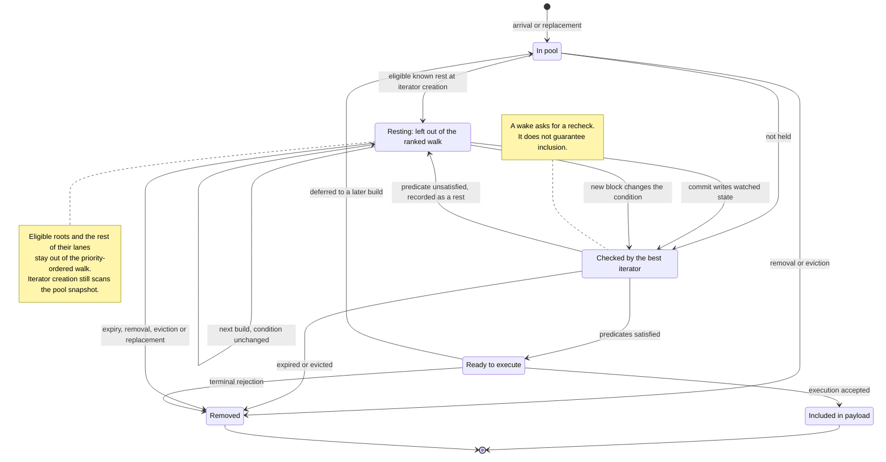
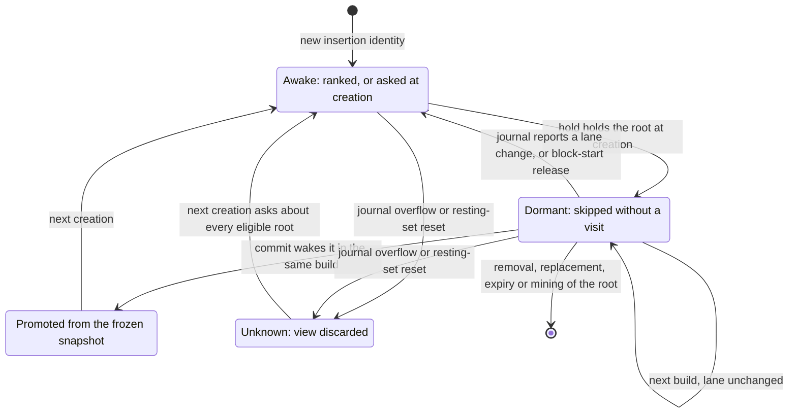

# `base-execution-txpool`

Transaction pool for Base.

## Overview

Extends Reth's transaction pool with Base-specific validation and ordering for the Base node.
`BaseTransactionValidator` enforces L1 data fee checks and Base-specific validity rules.
`BaseOrdering` and `TimestampOrdering` provide customizable transaction prioritization strategies.
Also includes a `BuilderApiImpl` for builder-specific pool management.

### Pluggable builder wire format

`ValidatedTransaction<E>` is the payload of `base_insertValidatedTransaction`, the endpoint mempool
nodes use to forward transactions to a builder. `E` carries additional wire fields and defaults to
`NoExtensions`, which encodes to exactly the same bytes as a struct without the field at all — so
the default is wire-compatible in both directions with peers that predate the parameter.

Downstream node builds substitute their own payload by implementing
`ValidatedTransactionExtensions<T>`, then registering the generic monomorphizations:

```rust,ignore
use base_execution_txpool::{
    BuilderApiImpl, BuilderApiServer, DEFAULT_MAX_VALIDITY_PREDICATES, ExtensionError,
    ValidatedTransactionExtensions,
};

#[derive(Debug, Clone, Default, serde::Serialize, serde::Deserialize)]
struct MyExtensions {
    #[serde(skip_serializing_if = "Option::is_none", default)]
    my_field: Option<u64>,
}

impl ValidatedTransactionExtensions<MyPooledTx> for MyExtensions {
    fn extract(tx: &ValidPoolTransaction<MyPooledTx>) -> Self { /* ... */ }
    fn apply(self, tx: MyPooledTx) -> Result<MyPooledTx, ExtensionError> { /* ... */ }
}

// Builder (ingress) side, in place of the stock `BuilderApiExtension`:
let api = BuilderApiImpl::<_, MyExtensions>::with_extensions(pool, true, DEFAULT_MAX_VALIDITY_PREDICATES);
modules.merge_configured(api.into_rpc())?;

// Mempool (egress) forwarding is provided by `base-tx-forwarding`.
```

Extension payloads must serialize as a JSON map (a braced struct, not a unit struct) and must avoid
`u128`/`i128` fields, which `serde_json` cannot represent through `#[serde(flatten)]`.

### Signed validity predicates

`TransactionValidity` carries off-chain predicates separately from the signed Ethereum
transaction. The transaction signature alone does **not** authorize those predicates.
Anyone holding the raw transaction can otherwise add a state predicate that delays
inclusion until their front-run has changed a pool's reserves. This can aid a sandwich
within the user's on-chain slippage limit; it does not change their signed calldata.

Use the shared `--validity-signature-mode off|verify-if-present|required` option
on forwarding ingress nodes and builders. It defaults to `off`: unsigned and signed
predicates are accepted without signature verification. Supplied signatures, even invalid
ones, are preserved for forwarding; malformed wire encodings and invalid predicate
parameters are still rejected. On builders the mode covers both
`base_sendRawTransactionValidity` and `base_insertValidatedTransaction`.

In `off` mode, nodes accept signed clients during rollout, but do not authenticate them.
Deploy `verify-if-present` to **every** ingress and builder so raw ingress verifies supplied signatures
while continuing to accept unsigned predicates. Migrate wallets and load clients to
signing, observe signed/unsigned admission counters, then switch the fleet to `required`.
At raw ingress, `required` rejects any non-empty predicate batch without valid sender
authorization. Builder insertion checks signature presence only and trusts the forwarder
to have verified it. Plain transactions need no extra signature.
Query nodes proxy sidecars unchanged and leave policy to the upstream sequencer.

**Off and optional verification modes are compatibility stages, not sandwich protection.**
As long as unsigned predicates are accepted, an intermediary can remove a
signature and submit different unsigned predicates. Do not claim protection
until **every forwarding ingress node** and each builder's raw ingress runs `required`,
each builder's insert policy requires signatures, and `base_insertValidatedTransaction`
is reachable only by trusted forwarders. A `required` builder alone is not protection:
an `off` forwarder can pass through a dummy signature and modified predicates, which
the builder's presence-only check will accept. Mixed-mode deployments are rollout
stages, not an authorization guarantee.

#### Wallet signing contract

Sign the EIP-712 digest returned by `ValidityAuthorization::signing_hash` using
`eth_signTypedData_v4` (not `personal_sign`). Submit the signature as
`validity_signature` alongside `validity` in the RPC options or builder payload.
It uses Alloy's signature JSON object (`r`, `s`, and `yParity` hex quantities).
The domain is `{ name: "Base Transaction Validity", version: "1", chainId }`;
`chainId` is the transaction's chain ID. There is no verifying contract.

```text
ValidityPredicate(uint8 kind,uint8 operator,address account,uint256 slot,uint256 mask,uint256 value)
ValidityAuthorization(bytes32 transactionHash,ValidityPredicate[] validity)
```

`transactionHash` hashes the complete signed EIP-2718 transaction envelope.
`kind` is balance = 0, storage = 1, block number = 2, flashblock index = 3, nonce = 4.
`operator` is `<` = 0, `<=` = 1, `=` = 2, `!=` = 3, `>` = 4, `>=` = 5.
Balance and nonce predicates use `account`; storage uses `account`, `slot`, and `mask`.
Nonce predicates read the account's protocol nonce, not an EIP-8130 channel nonce.
Unused fields are zero; omitted storage masks become `U256::MAX`.
`ValidityPredicateKind` and `ValidityOperator` define these explicit wire IDs.
All fields participate in each predicate's EIP-712 struct hash. Sort the typed
predicates by their struct hashes in ascending byte order before signing;
`ValidityAuthorization::canonical_predicates` builds this wallet-facing array.
Retain duplicates. Conjunction permutations produce the same digest; adding,
removing, or changing a predicate changes it. Evaluation uses its independent
cheap-first ordering and does not affect the signing contract.

Raw ingress reuses the recovered envelope sender to verify sidecar signatures
and rejects high-s signatures. Only sender-address secp256k1
authorization is supported; contract wallets or EIP-8130 actors without that
key cannot use signed sidecars. Deposits and unprotected legacy transactions
have no chain-bound signing domain and cannot authorize signed predicates.
Shadow-only predicate injection is incompatible with signature enforcement.
Predicates remain builder-side metadata, not on-chain consensus rules: a holder
can still strip the entire sidecar and submit the underlying plain transaction.
This feature prevents unauthorized predicate attachment, not all sandwich attacks.

`ValidityAuthorization::validate_recovered` reuses the sender already recovered at raw
ingress, including the builder's own `base_sendRawTransactionValidity` endpoint.
`base_insertValidatedTransaction` trusts forwarding mempool nodes to verify signatures
and only checks the local mode against signature presence. It does not recover either
the envelope sender or the sidecar signer again; restrict this endpoint to trusted forwarders.
Generic extension attachment does not take a validity-specific mode or enforce signature policy.
`with_validity(TransactionValidity)` attaches the sidecar without signature verification.
Raw ingress calls `validate_recovered` before attachment; the trusted builder insert
path attaches directly, then checks the local signature-presence policy.

`txpool.validity_signature.rejected{site,reason}` records bounded rejection reasons
at `ingress` and `builder`, independently of generic extension errors.
`txpool.validity_signature.accepted{site,signature}` separates signed and unsigned
sidecars to help operators assess migration readiness. RPC signature errors carry
the same stable rejection reason in their `data` field.

### Validity pool

`BaseTransactionPool` keeps three stores behind one `TransactionPool` surface:
the reth `Pool` for standard transactions, the EIP-8130 sidecar for finite
2D-nonce channels and nonce-free transactions, and a validity pool for every
transaction that carries validity predicates (conditional transactions), whatever
its envelope type. Validity transactions rest in the pool until a predicate on hot
state flips or their block or flashblock expiry passes, so the validity pool has
its own count, size and per-sender caps and evicts only among validity
transactions. A burst of conditional transactions therefore cannot push standard
user transactions out of reth's pending subpool, and reth's own eviction cannot
drop resting validity transactions.

EIP-7702 delegation and validity predicates do not mix. The validator rejects a
transaction with validity predicates that is an EIP-7702 transaction or comes
from a delegated sender, and a state diff that changes an account's code drops
that account's validity transactions. The validity pool therefore never needs
reth's in-flight limits for delegated accounts and pending authorizations, which
apply only inside reth.

`PoolStore::of` picks the store. A nonce slot `(sender, nonce key, nonce)`, or a
nonce-free replay id, is held by at most one store at a time: a newcomer bound for
another store replaces the incumbent under the usual price-bump rule and the
incumbent's listeners see `Replaced`. Account semantics span the stores: a
validity transaction right behind reth's or the sidecar's pending run is pending
(`LaneCursor::next_nonce` follows that run), while a standard transaction behind a
resting validity transaction stays queued in reth until the nonce gap closes.
`best_transactions` merges the three stores by priority but never yields a
sender's nonce `n + 1` before `n`: a validity head continuing a standard run waits
until the merge has yielded the transaction before it, and standard transactions
queued right behind a validity run are released by the merge once that run has
been yielded, so a predicate-delayed transaction does not keep its descendants out
of the same block. The lanes that straddle stores are indexed incrementally
(`TwoDNoncePool::lanes_ahead_of_state`, `shared_lanes_pending_end`), so cross-store
bookkeeping visits those indexed lanes rather than scanning both stores. The validity
snapshot still scans its lanes and copies references to their pending transactions;
`benches/best_transactions.rs` measures iterator construction on a large pool.

Capacity defaults to reth's pending subpool limit (`--txpool.pending-max-count`,
`--txpool.pending-max-size`, `--txpool.max-account-slots`) and is overridable with
`--rollup.validity-pool-max-count`, `--rollup.validity-pool-max-size` (megabytes)
and `--rollup.validity-pool-max-account-slots`; see `ValidityPoolLimits`.
Occupancy is published as `txpool.validity.pool_transactions` and
`txpool.validity.pool_bytes`, evictions as `txpool.validity.evicted`, and
replacements that crossed a store boundary as
`txpool.validity.cross_store_replaced{direction}`.

#### Resting transaction lifecycle

When a build finds a validity transaction's predicate unsatisfied, the builder records the
transaction as resting until a relevant state or block change. Pulling every resting
transaction through the best iterator's priority-ordered walk on every build, only to park it
again, would make selection cost grow with the number of resting transactions. The iterator
therefore leaves eligible resting transactions out of that walk until a relevant change wakes
them.

A lane is one sender's nonce sequence, and its root is the lane's first pending transaction.
Only roots ready from confirmed chain state, and nonce-free transactions, are eligible. A root
left out keeps the rest of its lane out too. Every other case takes the existing path: the
iterator offers the transaction, and the parking adapter checks whether to park it.

The diagram follows an eligible transaction with resting-predicate enforcement enabled:



A wake asks for a recheck; it does not guarantee inclusion. A commit wakes the rests whose
watched state it writes. A new block releases rests that read the block number for rechecking.
Expiry, removal and replacement invalidate the old transaction instead of waking it; a
replacement enters as a new transaction. An iterator that already exists keeps its snapshot,
so a stale candidate still faces normal nonce and validity checks.

Native builds create one iterator per payload; Flashblocks refreshes its iterator between
flashblocks. Both builders wake resting transactions after a commit in the same block. A failed
flashblock-index predicate is not recorded as a rest, because the index changes without a state
write; it is checked again at each new position.

##### Iterator details

`ParkableTransactionPool::best_transactions_with_attributes_and_parking` takes an
optional `BestTransactionsHold`. Payload builders pass one only when resting predicates are
enforced. Without a hold, the iterator matches `best_transactions`.
If the hold reports no resting transactions, creation skips the root checks. The parking
adapter still checks each candidate it reaches, so a transaction that starts resting after
creation is held normally.

With a hold, the iterator asks it about the validity pool's lane roots once, when the
iterator is created and before ranking. The pool's read guards are released first, so a hold
callback may use the pool. A root is asked about only if:

- it carries validity predicates;
- it is not underpriced at the iterator's base fee;
- it is nonce-free, or its lane starts at canonical state rather than behind another store's
  pending run (`TwoDNoncePool::lanes_ahead_of_state`).

A root the hold holds never enters the iterator's priority heap, and neither does the rest
of its lane. Every other candidate reaches the parking adapter, which checks whether to hold
it. That covers lanes behind another store's run, roots the hold declines, and roots
left unasked. The hold's `is_interrupted` is checked before the first root and every
`HOLD_INTERRUPT_INTERVAL` roots after that. Interruption stops the asking, and the remaining
roots take the lazy path.

`promote` on a root held at creation moves it to the ready set, behind any claimant of its
lane, and buffers the rest of its run behind it. A claimant is a lane member already yielded
or parked, or the adapter's cached next candidate in that lane; for example, the protocol
snapshot can hold a replacement at the root's nonce. The merge counts the root as yielded, so
standard transactions queued behind its run follow it after it commits. The adapter's cached
next candidate goes back into priority competition, so newly released successors are ranked
against it. Promotion fails for an unknown hash, a hash already promoted or discarded, or a
root whose lane was invalidated. `discard_parked` on a root held at creation invalidates its
lane for this iterator and yields nothing behind it.

Asking at creation marks every held root as seen by the resting set for that block, including
roots the build never reaches within its budget. Those members stay retained instead of aging
out in the unseen sweep, and the hold's parked counters include them. Seen marking affects
retention only; predicate applicability, predicate expiry and pool expiry are evaluated as
before.

Each iterator still gets a fresh snapshot. There is no persistent selection view, mutation
journal or cross-build snapshot cache. Snapshot scans, run copies and bridged-transaction
lookups remain. Eligible resting roots are still checked during creation; they skip the
priority-ordered walk, not all per-build work. This is a constant-factor saving.

##### Persistent selection view (proposed; staged stub only)

This section is the target contract for removing the remaining per-build resting work. Only
`SelectionView` and `ParkableTransactionPool::best_transactions_with_selection_view` exist, as a
staged stub that ignores the view; everything else here is proposed. The sections above describe
current behavior.

Goal: with resting-predicate enforcement on, building again on an unchanged pool and resting
set must not visit, copy, check, carry or drop the dormant population. A dormant root is an
eligible root (rules above) that a hold held at an earlier creation, together with its tail and
the standard transactions bridged behind it. Creation, draining, carry and drop cost the awake
lanes, the lanes changed since the view last synchronized and the actual wakes, measured at
20k, 40k and 75k resting transactions for both builders. Admission may pay an O(log n)
persistent update per mutation.

Contract:

- **Ownership.** A `SelectionView` belongs to one job lineage and travels with its resting set.
  There is no pool-wide dormancy flag. A job that starts with an empty resting set starts with
  an empty view and asks about every eligible root, as today. Concurrent jobs keep independent
  views and can disagree about the same root. The view stores root identities and a journal
  position only, so it is not generic over the transaction type and lives inside
  `RestingPredicates`. The snapshots an iterator reads come from the pool's persistent lane
  stores and its persistent mirror of the standard runs bridged behind shared lanes, shared in
  O(1) at creation.
- **Identity.** Dormancy is keyed by the root's insertion identity, not its hash. Removing and
  re-adding the same transaction creates a new identity, so the hold is asked again.
- **Creation.** An iterator asks the hold only about eligible roots that are new to the view or
  whose lane changed. It walks the awake roots in time proportional to their live count, never
  to capacity retained from earlier dormant populations.
- **Frozen snapshots.** An iterator captures an immutable snapshot of each dormant root, its
  tail and its bridged successors. Waking a root in the same build hands back that snapshot,
  exactly as `take_held` does today: a tail or bridged successor replaced after creation is still
  yielded in its captured form, and the replacement waits for the next iterator. Successors are
  never looked up live.
- **Changes.** The pool records every lane change in a bounded journal with sequence numbers:
  admission, replacement and removal in any store, cursor and anchor moves, canonical and
  account updates, and replacements of bridged standard successors that leave the validity
  cursor unchanged. Synchronizing a view wakes the dormant roots of the changed lanes and returns
  the insertion identities that left the pool, so the builder removes their rests from the
  resting set after the pool guards are released. The capacity starts at 16,384 entries;
  whether that covers the admissions between two syncs at production rates is unmeasured.
- **Wakes.** A commit that wakes a dormant root promotes it in the current iterator at once and
  makes it awake in the view. Block-start releases do the same before creation.
- **Expiry.** A rest keeps its transaction's whole `ValidityConditions`, captured when it rests
  or at the first sync that sees it. With flashblock index 0 the root is expired at once when
  either bound is below zero, from block `block.max + 1` otherwise, and never when `block.max`
  is at least `u64::MAX`. Expiry removes the root without asking the hold.
- **Recovery.** A view whose journal position has been overwritten, or whose resting set was
  reset (other parent, unknown pre-block writes, reorg, abandoned or cancelled job), is
  discarded. The next creation asks about every eligible root once, as today. Recovery never
  compares map snapshots (`OrdMap::diff` is not used) and never keeps stale dormancy.
- **Interruption.** A creation interrupted while synchronizing or asking leaves every root it did
  not finish awake; the adapter decides those lazily, as today.
- **Unchanged elsewhere.** Priority, claimant barriers, underpriced cut-offs, discard,
  cross-store nonce order, nonce-free and 2D-nonce lanes, `off` and `shadow` modes and the Denim
  gate behave as described above.
- **Accounting.** `RestingStats::parked` keeps counting roots the hold was asked about and held.
  Dormant roots skipped without a visit are reported as a separate count.
- **Reclamation.** A large discarded view is dropped on the existing `resting-sweep` worker
  through a bounded hand-off; when the hand-off is full the drop runs inline and is measured.



Non-goals: live successor lookups, a pool-wide dormancy token, changes to admission or
replacement rules, and an `imbl` upgrade. Only `imbl` 7.0.1 `get`, `insert`, `remove`, `split`
and `range` operations are allowed; `OrdMap::diff` has a known bug in that version.

## Usage

Add the dependency to your `Cargo.toml`:

```toml
[dependencies]
base-execution-txpool = { workspace = true }
```

```rust,ignore
use base_execution_txpool::{BaseOrdering, BaseTransactionPool, BaseTransactionValidator};

let pool = Pool::new(
    BaseTransactionValidator::new(client, evm),
    BaseOrdering::default(),
    config,
);
```

## License

Licensed under the [MIT License](https://github.com/base/base/blob/main/LICENSE).
