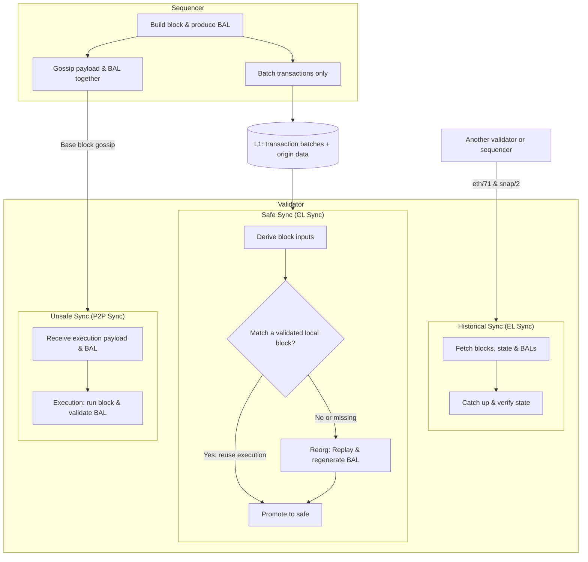

# Glamsterdam

## Contents

- [TODOs](#todos)
- [EIPs](#eips)
  - [Modified](#modified)
  - [Include As Is](#include-as-is)
- [Design](#design)
  - [Block-level access lists (EIP-7928)](#block-level-access-lists-eip-7928)
  - [Slot number (EIP-7843)](#slot-number-eip-7843)
  - [Calldata floor (EIP-7976)](#calldata-floor-eip-7976)
  - [Access-list pricing (EIP-7981)](#access-list-pricing-eip-7981)
  - [Resource-based intrinsic gas (EIP-2780)](#resource-based-intrinsic-gas-eip-2780)
- [Not included](#not-included)
- [References](#references)

## TODOs

- [ ] **Base Transactions (EIP-8430):** Define transaction pricing.
- [ ] **State creation (EIP-8037):** Choose Base's gas price per byte of new state.
- [ ] **State access (EIP-8038):** Choose Base's account/storage access and write prices.
- [ ] **BAL Bandwidth Analysis:** Compare payload sizes with and without BALs, before and after compression.

## EIPs

### Modified

| EIP | Summary | Change Summary |
|---|---|---|
| [7928](https://eips.ethereum.org/EIPS/eip-7928) · [Design](#block-level-access-lists-eip-7928) | **Block-Level Access Lists:** Records block state accesses and changes to support parallel execution and faster state processing. | Gossip BALs with Base blocks; omit them from L1 batches and regenerate them during CL sync. |
| [2780](https://eips.ethereum.org/EIPS/eip-2780) · [Design](#resource-based-intrinsic-gas-eip-2780) | **Resource-based intrinsic transaction gas:** Replaces flat transaction overhead with charges for the resources actually consumed. | Extend the gas model to Base Transactions (EIP-8430), including batching, sponsorship, and nonce modes. |
| [7843](https://eips.ethereum.org/EIPS/eip-7843) · [Design](#slot-number-eip-7843) | **SLOTNUM opcode:** Exposes the current consensus slot through a new opcode and block-header field. | Use the L2 block number as the slot, rather than Ethereum's beacon slot. |
| [7976](https://eips.ethereum.org/EIPS/eip-7976) · [Design](#calldata-floor-eip-7976) | **Increase Calldata Floor Cost:** Raises the transaction calldata floor to 64 gas per byte. | Recommend 128 gas/byte instead of L1's 64 to reduce block sizes and calldata growth. |
| [8037](https://eips.ethereum.org/EIPS/eip-8037) | **State Creation Gas Cost Increase:** Reprices new state and meters state creation separately from execution. | Tune the state-byte price for Base; value TBD. |
| [8038](https://eips.ethereum.org/EIPS/eip-8038) | **State-access gas cost update:** Revises charges for account and storage accesses and writes. | Tune account/storage access and write prices for Base; values TBD. |
| [7981](https://eips.ethereum.org/EIPS/eip-7981) · [Design](#access-list-pricing-eip-7981) | **Increase Access List Cost:** Charges transaction access lists for their data footprint. | Match EIP-7976's calldata floor: 128 gas/byte. |

### Include As Is

| EIP | Summary | Change Summary |
|---|---|---|
| [7708](https://eips.ethereum.org/EIPS/eip-7708) | **ETH transfers emit a log:** Adds protocol-generated logs for native ETH transfers. | Same as L1. |
| [7778](https://eips.ethereum.org/EIPS/eip-7778) | **Block Gas Accounting without Refunds:** Counts pre-refund execution work against block capacity while retaining user refunds. | Same as L1. |
| [7954](https://eips.ethereum.org/EIPS/eip-7954) | **Increase Maximum Contract Size:** Raises deployed-code and initcode limits to 64 KiB and 128 KiB respectively. | Same as L1. |
| [7997](https://eips.ethereum.org/EIPS/eip-7997) | **Deterministic Factory Contract:** Requires the standard `CREATE2` factory at a common address across EVM chains. | Same as L1. |
| [8024](https://eips.ethereum.org/EIPS/eip-8024) | **Backward compatible SWAPN, DUPN, EXCHANGE:** Adds instructions for accessing and rearranging deeper stack items. | Same as L1. |
| [8246](https://eips.ethereum.org/EIPS/eip-8246) | **Remove SELFDESTRUCT Burn:** Preserves remaining ETH balances when eligible self-destructed accounts are cleared. | Same as L1. |
| [7975](https://eips.ethereum.org/EIPS/eip-7975) | **eth/70—partial block receipt lists** (networking): Allows large receipt lists to be transferred in parts. | Same as L1. |
| [8159](https://eips.ethereum.org/EIPS/eip-8159) | **eth/71—Block Access List Exchange** (networking): Adds peer requests and responses for block access lists. | Same as L1. |
| [8189](https://eips.ethereum.org/EIPS/eip-8189) | **snap/2—BAL-Based State Healing** (networking): Uses block access lists to advance and repair downloaded state during synchronization. | Same as L1. |

## Design

### Block-level access lists (EIP-7928)

#### Goals

- **Fast Validator Sync (Tip and Historical)**
- **Minimize L1 Blob Requirements**

#### Architecture

#### Differences from L1

- **Gossip:** Include the BAL in the gossiped block's execution payload, not as a separate sidecar, so validators receive the block and BAL together without another fetch.
  - **Higher node bandwidth:** Validators are expected to run on high-bandwidth data-center connections, so extra peer traffic is an acceptable cost for avoiding a separate BAL fetch.
- **L1 blobs:** Publish transaction batches only. BALs can be regenerated from execution, including L1-derived deposits and system inputs.
  - **Slower CL sync:** Historical catch-up uses EL sync, and CL reconciliation should match already validated blocks without re-execution in normal operation. Accepting slower replay during exceptional recovery avoids paying L1 blob costs for BALs on every block.

### Slot number (EIP-7843)

| Option | Pros | Cons | Use cases |
|---|---|---|---|
| **L2 block number (recommended)** | Simple to validate. Every Base block has a distinct slot. Leaves room for a future Base slot counter that advances across skipped blocks. | Already available via `NUMBER` today. | Schedule local execution or track recent state by L2 block. |
| **L1 origin's beacon slot** | Follows OP's L1 consensus-data precedent (e.g. [EIP-4399](https://docs.base.org/specifications/base-protocol/execution/l2-execution-engine), [EIP-4788](https://docs.base.org/specifications/base-protocol/execution/l2-execution-engine)). | Multiple L2 blocks share a slot. Advances only with the L1 origin. | Align Ethereum oracle reporting periods or reference beacon-proof slots. |

### Calldata floor (EIP-7976)

`charged gas = max(txn cost, base_tx_cost + bytes * constant)`

**Recommendation: `constant = 128` gas/byte**, for both zero and nonzero bytes. This halves the calldata size and growth bounds compared with 64, without increasing costs in the sampled transaction comparison.

Priorities, in order:

1. **Transaction costs:** Avoid pricing out payments, swaps, and other common transactions.
2. **P2P block sizes:** Limit worst-case incompressible block sizes.
3. **Storage growth:** Keep yearly calldata growth manageable.

> **Note:** This is not the best mechanism to control L1 DA backlog: it prices raw calldata bytes without accounting for compression or available L1 DA capacity. More accurate L1 DA pricing should address that directly.

#### Transaction costs

| Transaction | Calldata bytes | Receipt gas |
|---|---|---|
| [USDC payment](https://basescan.org/tx/0x49c4bb7f80c94016db47bdf78e0654b8afa841622f78f8218a9f3b5d5871895c) | 68 | 40,271 |
| [Aerodrome Router swap](https://basescan.org/tx/0x2806baaddd14ea95cb8744183561efe9f2393347f4ed1e23396f51dba421efbf) | 324 | 181,916 |
| [Aerodrome Slipstream swap](https://basescan.org/tx/0x946ac8f533e9ebd1e1b75865e5a6c76673bd13170a4a73840f8c8e47c92d9c8a) | 260 | 186,366 |
| [Uniswap SwapRouter02 swap](https://basescan.org/tx/0x156a6324e1774e48d0437d714cec335fb3cfc35dc778a996ddb5e184486dbf17) | 228 | 105,413 |
| [Uniswap Universal Router swap](https://basescan.org/tx/0xab715150858242b67afb854b7eb6421dde55d5239893ebdbbfea97636d23a34f) | 644 | 171,148 |

| Constant (gas/byte) | USDC payment | Aerodrome Router | Slipstream | Uniswap Router02 | Universal Router |
|---|---|---|---|---|---|
| 64 | 40,271 | 181,916 | 186,366 | 105,413 | 171,148 |
| 🟩 **128** | 40,271 | 181,916 | 186,366 | 105,413 | 171,148 |
| 256 | 40,271 | 181,916 | 186,366 | 105,413 | **185,864** |
| 512 | **49,816** | 181,916 | 186,366 | **137,736** | **350,728** |
| 1,024 | **84,632** | **346,776** | **281,240** | **254,472** | **680,456** |

#### P2P block sizes and storage growth

##### Today: 400M gas/block · 2-second blocks

| Price per byte | Max calldata/block | Yearly growth | Gas to fill 10 MiB |
|---|---|---|---|
| [Zero bytes](https://eips.ethereum.org/EIPS/eip-7623) — 10 gas | 40 MB | 105.12 TB | ~105M |
| Blended — 30 gas | 13.33 MB | 35.04 TB | ~315M |
| [Nonzero bytes](https://eips.ethereum.org/EIPS/eip-7623) — 40 gas | 10 MB | 26.28 TB | ~419M |

##### Denim: 40M gas/block · 200 ms blocks

| Price per byte | Max calldata/block | Yearly growth | Gas to fill 10 MiB |
|---|---|---|---|
| [Zero bytes](https://eips.ethereum.org/EIPS/eip-7623) — 10 gas | 4 MB | 105.12 TB | ~105M |
| Blended — 30 gas | 1.33 MB | 35.04 TB | ~315M |
| [Nonzero bytes](https://eips.ethereum.org/EIPS/eip-7623) — 40 gas | 1 MB | 26.28 TB | ~419M |

##### 200M gas/s limit · 33.33M gas/s target

| Price per byte | Max calldata/block | Yearly growth | Gas to fill 10 MiB |
|---|---|---|---|
| 64 gas | 625 kB | 16.43 TB | ~671M |
| 🟩 **128 gas** | **312.5 kB** | **8.21 TB** | **~1.34B** |
| 256 gas | 156.25 kB | 4.11 TB | ~2.68B |
| 512 gas | 78.13 kB | 2.05 TB | ~5.37B |

##### 1G gas/s limit · 166.67M gas/s target

| Price per byte | Max calldata/block | Yearly growth | Gas to fill 10 MiB |
|---|---|---|---|
| 64 gas | 3.13 MB | 82.13 TB | ~671M |
| 🟩 **128 gas** | **1.56 MB** | **41.06 TB** | **~1.34B** |
| 256 gas | 781.25 kB | 20.53 TB | ~2.68B |
| 512 gas | 390.63 kB | 10.27 TB | ~5.37B |

### Access-list pricing (EIP-7981)

Access-list data pricing must match the [EIP-7976 calldata floor](#calldata-floor-eip-7976): **128 gas/byte**. Access lists also consume block space, so matching the rate prevents them from becoming a cheaper way to include data.

| Entry | Bytes | L1 data surcharge (64 gas/byte) | Base data surcharge (128 gas/byte) |
|---|---|---|---|
| Address | 20 | 1,280 gas | 2,560 gas |
| Storage key | 32 | 2,048 gas | 4,096 gas |

### Resource-based intrinsic gas (EIP-2780)

#### Motivation for Base

Base's intrinsic base is a flat `21,000` for legacy and typed transactions, and a bespoke schedule for Base Transactions (EIP-8430). Both are fixed constants: a zero-value call and a value transfer that creates an account pay the same base, even though the second touches an extra account, writes an extra balance, emits a transfer log, and permanently grows the state.

Denim's 200 ms blocks raise the transaction rate and lower the work per block, so the fixed per-transaction work — signature recovery, sender account access, and the sender's leaf write — becomes a larger share of block time. Pricing each of those primitives separately tracks real resource use better than one constant, and it lets the EIP-8037 and EIP-8038 repricings flow through the base instead of forcing Base to maintain a separate constant.

#### What L1 EIP-2780 changes

EIP-2780 splits the flat base into **intrinsic gas** (state-independent, the sole input to the validity check) and **runtime gas** (state-dependent, charged in a pre-execution phase). Running out of runtime gas does not invalidate the transaction: it is included, execution is skipped, and the pre-execution state changes are reverted.

| Transaction shape | Intrinsic today | EIP-2780 intrinsic | EIP-2780 runtime |
| :--- | :---: | :--- | :--- |
| Self-transfer | `21,000` | `TX_BASE_COST` = 12,000 | — |
| Zero-value call to an EOA | `21,000` | 12,000 + `COLD_ACCOUNT_ACCESS` = 15,000 | — |
| Value transfer to an existing EOA | `21,000` | 12,000 + `COLD_ACCOUNT_ACCESS` + `TX_VALUE_COST` = 21,000 | — |
| Value transfer creating an account | `21,000` | 21,000 | `STATE_BYTES_PER_NEW_ACCOUNT × CPSB` state gas |
| Contract creation | `21,000` + 32,000 = 53,000 | `TX_BASE_COST` + `CREATE_ACCESS` = 24,000 | `STATE_BYTES_PER_NEW_ACCOUNT × CPSB` state gas if the target does not exist |
| EIP-7702 transaction | 25,000 per authorization, 12,500 refunded for an existing authority | `EXECUTION_PER_AUTH_BASE_COST` = 7,816 per authorization | `ACCOUNT_WRITE`, plus new-account and delegation-bytes state gas |

**Version note.** The L1 values above are the current EIP-2780 values, as implemented in revm 43. Base's pinned revm is 42.x, which implements an earlier draft of the EIP: its `TX_VALUE_COST` is 4,244 plus a separate 1,756 transfer-log cost, and its value-bearing `CREATE` still adds that 1,756, giving 25,756 rather than 24,000. The dependency must be aligned to revm 43 (or equivalent) before activation, so revm 43 is cited here as the forward reference.

The calldata floor keeps its per-byte schedule; only the flat `21,000` term it sits on is replaced by the transaction's decomposed base, so the floor never undercuts the transaction's own intrinsic base.

#### Base differences

**Base Transactions (EIP-8430).** A Base Transaction (transaction type `0x79`) already has a decomposed intrinsic schedule: it batches calls, sponsors gas through a payer, and supports the account nonce, 2D nonce keys, and nonce-free mode. EIP-2780 extends to it by mapping its primitives onto that schedule, not by replacing it. The implementing code keeps the `eip8130` name.

| EIP-2780 primitive | Base Transaction equivalent | Change |
| :--- | :--- | :--- |
| `TX_BASE_COST` — recovery, sender access, sender write, inclusion | `AA_BASE_COST` = 15,000 — decoding, sender resolution, nonce-mode dispatch, payer settlement, receipt assembly | **Keep 15,000.** The AA transport does more fixed work per transaction than a typed transaction; reducing it to 12,000 would underprice decoding, nonce dispatch, and payer settlement. |
| `COLD_ACCOUNT_ACCESS` for `tx.to` | No intrinsic charge; each call is a real EVM frame metered warm/cold under EIP-8038 | **None.** EIP-2780 charges the single top-level recipient intrinsically because there is exactly one; an AA transaction has one recipient per call, each charged when it executes. |
| `TX_VALUE_COST` for `tx.value` | `value_transfer_cost`, charged per call with `value > 0` and `to != sender` | **Keep 6,000 per value-bearing call.** Batching means N value-bearing calls pay N × 6,000, not one. |
| New-account state gas | Account-creation charge applied before the callee runs | Charge `STATE_BYTES_PER_NEW_ACCOUNT × CPSB` state gas per call that creates an account, at runtime. |
| Delegation-indicator state gas | `DELEGATION_DEPOSIT_COST` = 200 × 23 = 4,600 regular gas for an explicit delegation entry | Move the 23-byte indicator to `STATE_BYTES_PER_AUTH_BASE × CPSB` state gas. |
| EIP-7702 authorization decomposition | No `authorization_list`; the delegation entry is authorized by `sender_auth` | No `EXECUTION_PER_AUTH_BASE_COST`. A delegation entry that materializes a previously non-existent sender leaf charges `STATE_BYTES_PER_NEW_ACCOUNT × CPSB` for that leaf plus `STATE_BYTES_PER_AUTH_BASE × CPSB` for a net-new indicator. |

**Sponsorship and the payer.** `payer_auth_cost` is metered on top of `gas_limit` so a sponsored payer cannot starve `calls`, and already covers the payer's recovery and one cold account-state read. EIP-2780's sender base covers the sender's leaf write; a sponsored transaction writes a second account leaf, the payer's fee debit. **Proposal:** charge `ACCOUNT_WRITE` in execution gas once for the payer's first write when `payer != sender`, and nothing when the payer is the sender, whose write is already inside `AA_BASE_COST`.

**Nonce modes.** EIP-2780 alone does not change `nonce_key_cost`. It prices the nonce-manager replay state — 0 for the account nonce, 13,000 for nonce-free ring-buffer state, 22,100 for the first use of a sequenced key, and 5,000 for an existing one — which EIP-2780 has no primitive for. Whether the EIP-8037 state-byte price or the EIP-8038 access and write prices reprice the storage primitives these composites are built from is owned by those designs; nonce-free mode keeps its fixed composite.

**Deposits and system transactions.** Exempt. Deposit transactions (type `0x7E`) carry no signature and no fee, and the L1-attributes deposit is protocol-injected. A deposit does carry a user-chosen `to`, `value`, and input from its L1 transaction, but its gas is funded on L1 rather than by an L2 sender, so the decomposition does not apply.

**Calldata floor.** EIP-2780 replaces the flat `21,000` term in the EIP-7623 floor with the decomposed base, excluding per-authorization and initcode-word charges. Base's 128 gas/byte rate (see [Calldata floor](#calldata-floor-eip-7976)) is a proposal, not active, and the matching access-list rate (see [Access-list pricing](#access-list-pricing-eip-7981)) is proposed alongside it; EIP-2780 moves only the base term, so the per-byte rate is unchanged either way. Base Transactions keep their own floor over the serialized transaction and the payer blob, with the same decomposed sender base.

**200 ms blocks.** Validity drops to `TX_BASE_COST + COLD_ACCOUNT_ACCESS` (15,000) for a zero-value call, so more transactions pass the validity check. The per-block transaction count stays bounded by the gas limit and by the fixed per-transaction work that intrinsic gas prices. A transaction that passes the intrinsic check but cannot afford a runtime charge is included, halted, and reverted. Its runtime charges and the EIP-8037 state-gas reservoir are funded from `gas_limit` itself, so a builder's envelope is `gas_limit` plus the payer's authentication (`payer_auth`), not `gas_limit` plus the runtime charges. Block accounting counts execution gas pre-refund under [EIP-7778](https://eips.ethereum.org/EIPS/eip-7778), including halted transactions, and net state gas after EIP-8037 refills rather than the gross runtime charge.

**State creation and access pricing.** EIP-2780's runtime charges are EIP-8037 state gas (`STATE_BYTES_PER_NEW_ACCOUNT × CPSB` per new account, `STATE_BYTES_PER_AUTH_BASE × CPSB` per net-new delegation indicator), and its intrinsic and runtime access charges come from EIP-8038 (`COLD_ACCOUNT_ACCESS`, `WARM_ACCESS`, `ACCOUNT_WRITE`, `CREATE_ACCESS`). This design does not fix `CPSB` or the EIP-8038 prices for Base; those are chosen in the EIP-8037 and EIP-8038 specs. The table below carries the L1 values as placeholders.

**EIP-7702.** The flat 25,000-per-authorization intrinsic charge and its refund are replaced by `EXECUTION_PER_AUTH_BASE_COST` = 7,816 (calldata, recovery, cold authority access, and warm writes) at the intrinsic phase, plus runtime charges per authority: `STATE_BYTES_PER_NEW_ACCOUNT × CPSB` state gas when the authority does not exist, `ACCOUNT_WRITE` execution gas for its first write (skipped when the sender base, the value cost, or a preceding authorization already paid it), and `STATE_BYTES_PER_AUTH_BASE × CPSB` state gas for net-new delegation bytes. Resolving a delegation stays a runtime `COLD_ACCOUNT_ACCESS` or `WARM_ACCESS` charge. Base activates EIP-7702 at Isthmus, so this applies to existing delegated accounts.

#### Parameters

L1 values are the EIP-2780 defaults. Base adopts them unless noted; `CPSB` and the EIP-8038 prices are decided in the EIP-8037 and EIP-8038 specs.

| Name | Source | Base value |
| :--- | :--- | :--- |
| `TX_BASE_COST` | EIP-2780 | 12,000 for typed transactions; Base Transactions keep `AA_BASE_COST` = 15,000 |
| `TX_VALUE_COST` | EIP-2780 | 6,000, per value-bearing call for Base Transactions |
| `COLD_ACCOUNT_ACCESS` | EIP-8038 | 3,000 (TBD in the EIP-8038 PR) |
| `WARM_ACCESS` | EIP-8038 | 100 (TBD in the EIP-8038 PR) |
| `ACCOUNT_WRITE` | EIP-8038 | 9,000 (TBD in the EIP-8038 PR) |
| `CREATE_ACCESS` | EIP-8038 | 12,000 (TBD in the EIP-8038 PR) |
| `EXECUTION_PER_AUTH_BASE_COST` | EIP-8037 | 7,816 |
| `STATE_BYTES_PER_NEW_ACCOUNT × CPSB` | EIP-8037 | TBD (decided in the EIP-8037 PR) |
| `STATE_BYTES_PER_AUTH_BASE × CPSB` | EIP-8037 | TBD (decided in the EIP-8037 PR) |

#### Touch points

- **Consensus.** Intrinsic gas and the runtime pre-execution phase are consensus-critical for every transaction type, including the Base Transaction executor's enshrined schedule. All nodes must agree on the decomposition before activation.
- **Block building.** Block gas accounting counts execution gas pre-refund under [EIP-7778](https://eips.ethereum.org/EIPS/eip-7778), including transactions that halt in the runtime phase, and counts net state gas after EIP-8037 refills rather than the gross runtime charge. The builder's envelope is `gas_limit` plus the payer's authentication (`payer_auth`); the runtime charges and the EIP-8037 state-gas reservoir are funded from `gas_limit`, so they must not be reserved again on top.
- **Txpool.** Validity stays intrinsic-only, but admission should reject a transaction whose `gas_limit` cannot cover a runtime charge it is certain to incur against current state — a value transfer to a non-existent recipient, a transfer to a delegated account, or a delegation from a new authority — so blocks are not filled with transactions guaranteed to halt.
- **RPC estimation.** `eth_estimateGas` must return a limit covering the intrinsic base, the runtime charges (new-account state gas and delegation-target access), and execution gas. The Base Transaction estimator prices intrinsic and authentication once from the request and binary-searches the call pool, so it needs the same runtime terms added.
- **Receipts.** `gasUsed` includes the runtime charges, as on L1.

#### Open questions

1. **Sender base for Base Transactions.** Keep `AA_BASE_COST` = 15,000, or reduce it to `TX_BASE_COST` = 12,000 and price the AA-specific work (decoding, nonce-mode dispatch, payer settlement) as its own primitives?
2. **Payer write and its budget.** Charge `ACCOUNT_WRITE` once for a sponsored payer's first write, or fold it into `payer_auth_cost`? Charging it matches EIP-2780's one-write-per-leaf rule; folding it keeps the payer cost a single number. Either way, decide which budget funds it — the sender's `gas_limit` or an extra payer reserve on top of `gas_limit` — and keep the pre-charge, caps, transaction selection, estimation, and settlement consistent with that choice.
3. **Per-call access.** Should a Base Transaction charge a fixed per-call `COLD_ACCOUNT_ACCESS` intrinsically, as EIP-2780 does for its single top-level recipient, or rely on per-call EVM warm/cold metering? Metering is the closer analogue of an internal `CALL` and keeps intrinsic gas a function of the transaction body alone.
4. **Base Transaction calldata floor.** Adopt Base's 128 gas/byte rate for the AA payload, keep EIP-8430's 10-gas-per-token floor, or set a separate rate?
5. **Throughput anchor.** L1 selected its costs against a 75 Mgas/s target. Should Base re-derive `TX_BASE_COST` and `TX_VALUE_COST` against Denim's throughput target, or adopt L1's values and tune only `CPSB` and the EIP-8038 prices?
6. **Guaranteed-revert admission.** Should the txpool reject transactions that cannot afford a runtime charge they are certain to incur, or accept them because they are valid and pay for the gas they consume?
7. **Native Keystore Create pricing.** The enshrined Keystore create path charges its own deployment base and per-byte code deposit and installs code directly rather than through EVM `CREATE`. Which parts of that charge move to EIP-8037 state gas, and how the state-gas reservoir merges and rolls back across Base Transaction call phases, is owned by the EIP-8037 design rather than settled here.

## Not included

| EIP | Summary | Relevant |
|---|---|---|
| [7688](https://eips.ethereum.org/EIPS/eip-7688) | **Forward compatible consensus data structures:** Makes Ethereum consensus structures easier to extend without breaking existing proofs. | Changes Ethereum beacon-chain structures rather than Base's L2 execution rules. |
| [7732](https://eips.ethereum.org/EIPS/eip-7732) | **Enshrined Proposer-Builder Separation:** Moves proposer/builder separation into Ethereum's consensus protocol. | Base's sequencing architecture does not use Ethereum's beacon proposer/builder mechanism. |
| [8045](https://eips.ethereum.org/EIPS/eip-8045) | **Exclude slashed validators from proposing:** Prevents slashed Ethereum validators from being selected as proposers. | Base does not use Ethereum's validator proposer-selection rules for L2 blocks. |
| [8061](https://eips.ethereum.org/EIPS/eip-8061) | **Increase exit and consolidation churn:** Increases Ethereum validator exit and consolidation capacity. | Ethereum staking queues are outside Base's L2 protocol. |
| [8282](https://eips.ethereum.org/EIPS/eip-8282) | **Builder Execution Requests:** Adds contracts and execution requests for ePBS builder deposits and exits. | These manage Ethereum's staked ePBS builders, which Base's L2 sequencing does not use. |
| [8070](https://eips.ethereum.org/EIPS/eip-8070) | **eth/72—Sparse Blobpool** (networking): Lets peers exchange selected blob cells instead of always retaining full blob sidecars. | Applies to Ethereum's blob pool; Base publishes blobs on L1 rather than supporting an equivalent L2 blob pool. |
| [8136](https://eips.ethereum.org/EIPS/eip-8136) | **Cell-Level Deltas for Data Column Broadcast** (networking): Avoids retransmitting blob cells peers already possess. | Applies to Ethereum PeerDAS networking, with indirect benefits to Base's L1 data availability. |
| [7904](https://eips.ethereum.org/EIPS/eip-7904) | **Compute Gas Cost Analysis** (informational): Reports benchmarks concluding that no compute gas repricing is required at the studied throughput. | Specifies no protocol change for Base to adopt. |
| [8261](https://eips.ethereum.org/EIPS/eip-8261) | **Gas Limit Schedule** (informational): Recommends epoch-based gas-limit defaults in Ethereum consensus-client configuration. | Base controls its L2 gas limit separately from Ethereum validator preferences. |

## References

- [Glamsterdam meta-EIP (EIP-7773)](https://eips.ethereum.org/EIPS/eip-7773)
- [Resource-based transaction gas (EIP-2780)](https://eips.ethereum.org/EIPS/eip-2780)
- [EIP-2780 gas-cost report](https://github.com/ethereum/EIPs/blob/master/assets/eip-2780/gas-cost-report.md)
- [revm 43's EIP-2780 intrinsic-gas decomposition (forward reference)](https://docs.rs/revm-primitives/43.0.0/src/revm_primitives/eip2780.rs.html)
- [Calldata floor specification (EIP-7976)](https://eips.ethereum.org/EIPS/eip-7976)
- [Calldata floor (EIP-7623)](https://eips.ethereum.org/EIPS/eip-7623)
- [Access-list data pricing (EIP-7981)](https://eips.ethereum.org/EIPS/eip-7981)
- [Base gas limits, block time, and fee parameters](https://docs.base.org/specifications/transactions/throughput-and-limits)
- [Base Transactions (EIP-8430)](https://github.com/chunter-cb/EIPs/blob/aa-transaction-type/EIPS/eip-8430.md)
- [State creation and gas reservoirs (EIP-8037)](https://eips.ethereum.org/EIPS/eip-8037)
- [Account and storage access pricing (EIP-8038)](https://eips.ethereum.org/EIPS/eip-8038)
- [SLOTNUM specification (EIP-7843)](https://eips.ethereum.org/EIPS/eip-7843)
- [SLOTNUM use-case discussion](https://ethereum-magicians.org/t/eip-7843-slotnum-opcode/22234)
- [OP Stack L1 consensus context: PREVRANDAO and beacon roots](https://docs.base.org/specifications/base-protocol/execution/l2-execution-engine)
- [Conditional Transactions (EIP-7793, stagnant)](https://eips.ethereum.org/EIPS/eip-7793)
- [Recent Roots for Frame Transactions (EIP-8272, draft)](https://eips.ethereum.org/EIPS/eip-8272)
- [Block-level access lists (EIP-7928)](https://eips.ethereum.org/EIPS/eip-7928)
- [BAL exchange over eth/71 (EIP-8159)](https://eips.ethereum.org/EIPS/eip-8159)
- [BAL-based state healing over snap/2 (EIP-8189)](https://eips.ethereum.org/EIPS/eip-8189)
- [Base L1 derivation and batch format](https://docs.base.org/specifications/base-protocol/consensus/derivation)
- [Base rollup-node P2P and block gossip specification](https://docs.base.org/specifications/base-protocol/consensus/p2p)
- [Reth v2.7.0 BAL storage and pruning](https://github.com/paradigmxyz/reth/blob/v2.7.0/crates/storage/provider/src/bal/rocksdb.rs)
- [Base's pinned Reth fork](https://github.com/base/reth/tree/base-v2.7.0.1)
- [Reth v2.7.0 release notes](https://github.com/paradigmxyz/reth/releases/tag/v2.7.0)
- [v2.7.0 source and pinned dependencies](https://github.com/paradigmxyz/reth/tree/v2.7.0)
- [revm's Amsterdam gas rules](https://docs.rs/revm-context-interface/43.0.2/src/revm_context_interface/cfg/gas_params.rs.html)
- [Reth networking implementations](https://github.com/paradigmxyz/reth/tree/v2.7.0/crates/net)
- [BAL-based synchronization](https://github.com/paradigmxyz/reth/tree/v2.7.0/crates/snap-sync)
