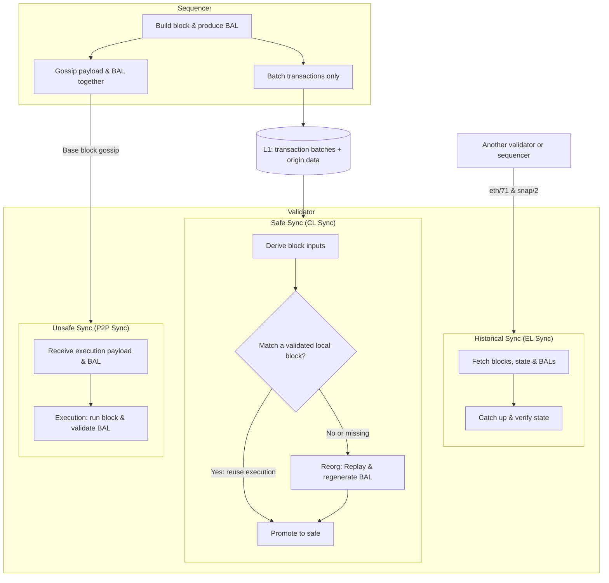

# Glamsterdam

## Contents

- [TODOs](#todos)
- [EIPs](#eips)
  - [Modified](#modified)
  - [Include As Is](#include-as-is)
- [Design](#design)
  - [Block-level access lists (EIP-7928)](#block-level-access-lists-eip-7928)
  - [Slot number (EIP-7843)](#slot-number-eip-7843)
  - [Calldata floor (EIP-7976)](#calldata-floor-eip-7976)
  - [Access-list pricing (EIP-7981)](#access-list-pricing-eip-7981)
  - [State creation (EIP-8037)](#state-creation-eip-8037)
- [Not included](#not-included)
- [References](#references)

## TODOs

- [ ] **Base Transactions (EIP-8430):** Define transaction pricing.
- [ ] **State creation (EIP-8037):** Agree the proposed 1,000 gas/byte price at 80M and deposit/Base Transaction accounting.
- [ ] **State access (EIP-8038):** Choose Base's account/storage access and write prices.
- [ ] **BAL Bandwidth Analysis:** Compare payload sizes with and without BALs, before and after compression.

## EIPs

### Modified

| EIP | Summary | Change Summary |
|---|---|---|
| [7928](https://eips.ethereum.org/EIPS/eip-7928) · [Design](#block-level-access-lists-eip-7928) | **Block-Level Access Lists:** Records block state accesses and changes to support parallel execution and faster state processing. | Gossip BALs with Base blocks; omit them from L1 batches and regenerate them during CL sync. |
| [2780](https://eips.ethereum.org/EIPS/eip-2780) | **Resource-based intrinsic transaction gas:** Replaces flat transaction overhead with charges for the resources actually consumed. | Extend the gas model to Base Transactions (EIP-8430), including batching, sponsorship, and nonce modes. |
| [7843](https://eips.ethereum.org/EIPS/eip-7843) · [Design](#slot-number-eip-7843) | **SLOTNUM opcode:** Exposes the current consensus slot through a new opcode and block-header field. | Use the L2 block number as the slot, rather than Ethereum's beacon slot. |
| [7976](https://eips.ethereum.org/EIPS/eip-7976) · [Design](#calldata-floor-eip-7976) | **Increase Calldata Floor Cost:** Raises the transaction calldata floor to 64 gas per byte. | Recommend 128 gas/byte instead of L1's 64 to reduce block sizes and calldata growth. |
| [8037](https://eips.ethereum.org/EIPS/eip-8037) · [Design](#state-creation-eip-8037) | **State Creation Gas Cost Increase:** Reprices new state and meters state creation separately from execution. | Recommend 1,000 gas per new state byte at an 80M post-Glamsterdam block limit; retain 533 at 40M as the reference. |
| [8038](https://eips.ethereum.org/EIPS/eip-8038) | **State-access gas cost update:** Revises charges for account and storage accesses and writes. | Tune account/storage access and write prices for Base; values TBD. |
| [7981](https://eips.ethereum.org/EIPS/eip-7981) · [Design](#access-list-pricing-eip-7981) | **Increase Access List Cost:** Charges transaction access lists for their data footprint. | Match EIP-7976's calldata floor: 128 gas/byte. |

### Include As Is

| EIP | Summary | Change Summary |
|---|---|---|
| [7708](https://eips.ethereum.org/EIPS/eip-7708) | **ETH transfers emit a log:** Adds protocol-generated logs for native ETH transfers. | Same as L1. |
| [7778](https://eips.ethereum.org/EIPS/eip-7778) | **Block Gas Accounting without Refunds:** Counts pre-refund execution work against block capacity while retaining user refunds. | Same as L1. |
| [7954](https://eips.ethereum.org/EIPS/eip-7954) | **Increase Maximum Contract Size:** Raises deployed-code and initcode limits to 64 KiB and 128 KiB respectively. | Same as L1. |
| [7997](https://eips.ethereum.org/EIPS/eip-7997) | **Deterministic Factory Contract:** Requires the standard `CREATE2` factory at a common address across EVM chains. | Same as L1. |
| [8024](https://eips.ethereum.org/EIPS/eip-8024) | **Backward compatible SWAPN, DUPN, EXCHANGE:** Adds instructions for accessing and rearranging deeper stack items. | Same as L1. |
| [8246](https://eips.ethereum.org/EIPS/eip-8246) | **Remove SELFDESTRUCT Burn:** Preserves remaining ETH balances when eligible self-destructed accounts are cleared. | Same as L1. |
| [7975](https://eips.ethereum.org/EIPS/eip-7975) | **eth/70—partial block receipt lists** (networking): Allows large receipt lists to be transferred in parts. | Same as L1. |
| [8159](https://eips.ethereum.org/EIPS/eip-8159) | **eth/71—Block Access List Exchange** (networking): Adds peer requests and responses for block access lists. | Same as L1. |
| [8189](https://eips.ethereum.org/EIPS/eip-8189) | **snap/2—BAL-Based State Healing** (networking): Uses block access lists to advance and repair downloaded state during synchronization. | Same as L1. |

## Design

### Block-level access lists (EIP-7928)

#### Goals

- **Fast Validator Sync (Tip and Historical)**
- **Minimize L1 Blob Requirements**

#### Architecture

#### Differences from L1

- **Gossip:** Include the BAL in the gossiped block's execution payload, not as a separate sidecar, so validators receive the block and BAL together without another fetch.
  - **Higher node bandwidth:** Validators are expected to run on high-bandwidth data-center connections, so extra peer traffic is an acceptable cost for avoiding a separate BAL fetch.
- **L1 blobs:** Publish transaction batches only. BALs can be regenerated from execution, including L1-derived deposits and system inputs.
  - **Slower CL sync:** Historical catch-up uses EL sync, and CL reconciliation should match already validated blocks without re-execution in normal operation. Accepting slower replay during exceptional recovery avoids paying L1 blob costs for BALs on every block.

### Slot number (EIP-7843)

| Option | Pros | Cons | Use cases |
|---|---|---|---|
| **L2 block number (recommended)** | Simple to validate. Every Base block has a distinct slot. Leaves room for a future Base slot counter that advances across skipped blocks. | Already available via `NUMBER` today. | Schedule local execution or track recent state by L2 block. |
| **L1 origin's beacon slot** | Follows OP's L1 consensus-data precedent (e.g. [EIP-4399](https://docs.base.org/specifications/base-protocol/execution/l2-execution-engine), [EIP-4788](https://docs.base.org/specifications/base-protocol/execution/l2-execution-engine)). | Multiple L2 blocks share a slot. Advances only with the L1 origin. | Align Ethereum oracle reporting periods or reference beacon-proof slots. |

### Calldata floor (EIP-7976)

`charged gas = max(txn cost, base_tx_cost + bytes * constant)`

**Recommendation: `constant = 128` gas/byte**, for both zero and nonzero bytes. This halves the calldata size and growth bounds compared with 64, without increasing costs in the sampled transaction comparison.

Priorities, in order:

1. **Transaction costs:** Avoid pricing out payments, swaps, and other common transactions.
2. **P2P block sizes:** Limit worst-case incompressible block sizes.
3. **Storage growth:** Keep yearly calldata growth manageable.

> **Note:** This is not the best mechanism to control L1 DA backlog: it prices raw calldata bytes without accounting for compression or available L1 DA capacity. More accurate L1 DA pricing should address that directly.

#### Transaction costs

| Transaction | Calldata bytes | Receipt gas |
|---|---|---|
| [USDC payment](https://basescan.org/tx/0x49c4bb7f80c94016db47bdf78e0654b8afa841622f78f8218a9f3b5d5871895c) | 68 | 40,271 |
| [Aerodrome Router swap](https://basescan.org/tx/0x2806baaddd14ea95cb8744183561efe9f2393347f4ed1e23396f51dba421efbf) | 324 | 181,916 |
| [Aerodrome Slipstream swap](https://basescan.org/tx/0x946ac8f533e9ebd1e1b75865e5a6c76673bd13170a4a73840f8c8e47c92d9c8a) | 260 | 186,366 |
| [Uniswap SwapRouter02 swap](https://basescan.org/tx/0x156a6324e1774e48d0437d714cec335fb3cfc35dc778a996ddb5e184486dbf17) | 228 | 105,413 |
| [Uniswap Universal Router swap](https://basescan.org/tx/0xab715150858242b67afb854b7eb6421dde55d5239893ebdbbfea97636d23a34f) | 644 | 171,148 |

| Constant (gas/byte) | USDC payment | Aerodrome Router | Slipstream | Uniswap Router02 | Universal Router |
|---|---|---|---|---|---|
| 64 | 40,271 | 181,916 | 186,366 | 105,413 | 171,148 |
| 🟩 **128** | 40,271 | 181,916 | 186,366 | 105,413 | 171,148 |
| 256 | 40,271 | 181,916 | 186,366 | 105,413 | **185,864** |
| 512 | **49,816** | 181,916 | 186,366 | **137,736** | **350,728** |
| 1,024 | **84,632** | **346,776** | **281,240** | **254,472** | **680,456** |

#### P2P block sizes and storage growth

##### Today: 400M gas/block · 2-second blocks

| Price per byte | Max calldata/block | Yearly growth | Gas to fill 10 MiB |
|---|---|---|---|
| [Zero bytes](https://eips.ethereum.org/EIPS/eip-7623) — 10 gas | 40 MB | 105.12 TB | ~105M |
| Blended — 30 gas | 13.33 MB | 35.04 TB | ~315M |
| [Nonzero bytes](https://eips.ethereum.org/EIPS/eip-7623) — 40 gas | 10 MB | 26.28 TB | ~419M |

##### Denim: 40M gas/block · 200 ms blocks

| Price per byte | Max calldata/block | Yearly growth | Gas to fill 10 MiB |
|---|---|---|---|
| [Zero bytes](https://eips.ethereum.org/EIPS/eip-7623) — 10 gas | 4 MB | 105.12 TB | ~105M |
| Blended — 30 gas | 1.33 MB | 35.04 TB | ~315M |
| [Nonzero bytes](https://eips.ethereum.org/EIPS/eip-7623) — 40 gas | 1 MB | 26.28 TB | ~419M |

##### 200M gas/s limit · 33.33M gas/s target

| Price per byte | Max calldata/block | Yearly growth | Gas to fill 10 MiB |
|---|---|---|---|
| 64 gas | 625 kB | 16.43 TB | ~671M |
| 🟩 **128 gas** | **312.5 kB** | **8.21 TB** | **~1.34B** |
| 256 gas | 156.25 kB | 4.11 TB | ~2.68B |
| 512 gas | 78.13 kB | 2.05 TB | ~5.37B |

##### 1G gas/s limit · 166.67M gas/s target

| Price per byte | Max calldata/block | Yearly growth | Gas to fill 10 MiB |
|---|---|---|---|
| 64 gas | 3.13 MB | 82.13 TB | ~671M |
| 🟩 **128 gas** | **1.56 MB** | **41.06 TB** | **~1.34B** |
| 256 gas | 781.25 kB | 20.53 TB | ~2.68B |
| 512 gas | 390.63 kB | 10.27 TB | ~5.37B |

### Access-list pricing (EIP-7981)

Access-list data pricing must match the [EIP-7976 calldata floor](#calldata-floor-eip-7976): **128 gas/byte**. Access lists also consume block space, so matching the rate prevents them from becoming a cheaper way to include data.

| Entry | Bytes | L1 data surcharge (64 gas/byte) | Base data surcharge (128 gas/byte) |
|---|---|---|---|
| Address | 20 | 1,280 gas | 2,560 gas |
| Storage key | 32 | 2,048 gas | 4,096 gas |

### State creation (EIP-8037)

#### Motivation for Base

**Recommendation: `COST_PER_STATE_BYTE` (`CPSB`) = 1,000 gas/byte at an 80M block limit.** Assume a roughly 2×, BAL-enabled limit increase after Glamsterdam: 80,000,000 gas per 200 ms block, or 400 Mgas/s. Retain 533 at 40M per 200 ms (200 Mgas/s) as the pre-raise reference; today's 400M per 2 seconds has that same reference throughput. This is a sizing assumption, not a measured BAL speedup or activation approval. L1's 1,530 gas/byte requires 100,453,680 state gas for a 64 KiB deployment to a new account, exceeding even an 80M block before execution costs.

#### What Base adopts from L1

- **Two dimensions, one fee.** Track independent cumulative execution gas `E` and state gas `S`, each bounded by the block limit `B`. Header `gas_used = max(E, S)` feeds the single EIP-1559 base fee, with target `B / elasticity`; there is no separate state target. Transactions pay execution plus state gas, so receipt cumulative gas need not equal header gas used. EIP-7778 counts execution before refunds; state gas is net of state-gas refills. The calldata floor applies to the execution dimension.
- **State-byte counts.** Charge 120 bytes per new account, 64 per new storage slot, and one per code byte. EIP-7702 charges 23 bytes for a net-new delegation indicator on an existing account, or 143 when it also creates the account. A `SELFDESTRUCT` transfer creating a beneficiary charges 120 bytes; self-destruction itself gives no state-gas refill.
- **Reservoir and rollback.** Follow EIP-8037's reservoir, refill, frame-merge, rollback, and refund rules. State charges draw from the reservoir first, then regular gas; undoing state creation restores the appropriate pools. The reservoir is inside the signed transaction gas limit, not an extra budget.
- **Transaction admission.** EIP-7825's 16,777,216 cap applies to regular execution gas, not total execution plus state gas. For ordinary transactions, require `min(16,777,216, tx.gas) <= execution_gas_available` and `tx.gas <= state_gas_available`, where each available budget is `B` minus its cumulative counter.

**Version note.** Base's pinned [revm 43](https://docs.rs/revm-handler/43.0.3/src/revm_handler/validation.rs.html) skips the EIP-7825 total-gas check when EIP-8037 is enabled; enabling it does not retain a 16.7M total cap. The [current upstream revision](https://github.com/ethereum/EIPs/blob/5ef380124bd68d09c02fa90d0de0f2455f37d5ee/EIPS/eip-8037.md) also caps `tx.gas` at 4,294,967,295. Adopt that bound when aligning the dependency before activation; the 80M block admission bound is tighter. These are proposed activation rules, not today's deployed Base gas schedule.

#### Parameters

| Parameter | L1 | Base |
|---|---|---|
| `CPSB` | 1,530 gas/byte | **1,000 gas/byte**, fixed at the 80M post-Glamsterdam limit; 533 at the 40M reference |
| `STATE_BYTES_PER_NEW_ACCOUNT` | 120 | Same |
| `STATE_BYTES_PER_STORAGE_SET` | 64 | Same |
| `STATE_BYTES_PER_AUTH_BASE` | 23 | Same |
| Maximum deployed code (EIP-7954) | 65,536 bytes | Same |

A maximum-size deployment to a new account meters `65,536 + 120 = 65,656` state bytes. Choose **5,000,000 gas for actual non-state costs combined**, including intrinsic gas, calldata charges, initcode and constructor execution, accesses, and hashing. Admission requires its total signed budget to fit the remaining state budget, even though block counters are separate:

`CPSB <= floor((B - 5,000,000) / 65,656) = 1,142` at `B = 80,000,000`.

At 1,000, state gas is **65,656,000**, leaving **14,344,000** for actual non-state gas; with the chosen 5M allowance, the combined budget is 70,656,000. The ceiling price of 1,142 leaves only 5,020,848. At the 40M reference, 533 gives 34,994,648 state gas and a 39,994,648 combined budget. These are sizing examples, not guarantees for arbitrary constructors or initcode; revisit the fixed price when the limit changes.

The EIP-8037 calldata floor is compared via `max()`, not added to actual `E + S` for admission: subtracting a 128 gas/byte floor reserve for 64 KiB initcode gives a conservative policy ceiling of 1,090, not a consensus limit; EIP-7976's upstream floor is 64 gas/byte.

| Operation | Today: legacy creation charge | Base: state gas at 1,000 (80M) | Base: state gas at 533 (40M) | L1: state gas at 1,530 |
|---|---|---|---|---|
| New storage slot | 20,000 | 64,000 | 34,112 | 97,920 |
| New account | 25,000 | 120,000 | 63,960 | 183,600 |
| Code, per byte | 200 | 1,000 | 533 | 1,530 |
| 64 KiB deploy to a new account: creation + code | 13,139,200 | 65,656,000 | 34,994,648 | 100,453,680 |
| EIP-7702 delegation, existing account | 25,000 before refund | 23,000 | 12,259 | 35,190 |
| EIP-7702 delegation, creating account | 25,000 | 143,000 | 76,219 | 218,790 |

The legacy deployment figure includes 32,000 for `CREATE` plus 200 per code byte; it is not a pure state-gas charge. EIP-7702's legacy existing-authority refund is 12,500, subject to the transaction refund cap; the creating case does not add another 12,500 charge. New columns exclude separate execution charges, including EIP-8038 access/write prices.

#### Rationale

Size the design case at the gas target with a balanced mix, and address worst cases through pricing. At elasticity 5, 80M gas every 200 ms gives a 16M/block or 80 Mgas/s target; elasticity 6 gives about 66.67 Mgas/s. Fixed CPSB 1,000 is a policy recommendation below the deployment ceiling, not a uniquely derived disk-budget optimum.

| Tier at the 80M limit | Annual growth | Basis |
|---|---|---|
| Expected, unchanged current demand | ~0.33–0.37 TB disk | Demand-driven live-state table-growth proxy; not assumed to double with capacity |
| Design, gas target × balanced mix | ~1.54 TB disk at elasticity 5 | Twice the 40M reference projection of ~0.77 TB; ~1.28 TB at elasticity 6 |
| Theoretical, full blocks × balanced mix | ~7.4–7.7 TB disk | Twice the 40M full-block projection; not sustainable at the minimum fee under EIP-1559 |
| Worst case, gas target entirely on new state | 2.52 / 2.10 TB metered at 1,000; 4.73 / 3.94 TB at 533 | Elasticity 5 / 6; `(80,000,000 / elasticity) × 5 blocks/s × 31,536,000 s/yr / CPSB` bytes/year; ignores execution overhead |

TB is decimal. Disk projections and EIP-metered bytes are different quantities: trie overhead, compression, and deletions prevent treating them as a calibrated conversion. These are planning scenarios, not measured post-upgrade outcomes or a guaranteed disk budget. The disk-growth proxy covers state-dominated tables, not the entire node volume. Validate the budget against matched telemetry, demand response, and production-like builder/import, state-root, persistence, compaction, and BAL transport measurements before activation.

Legacy cheapest-byte paths are approximately **175 gas/byte**, not just the 200 gas/byte code price: a 21,000-gas value transaction can create a 120-byte recipient, and creating EIP-7702 authorizations approach `25,000 / 143` gas/byte before outer-transaction overhead. At elasticity 5 these imply a smoothed legacy worst-target reference of **~7.2 TB/year at 40M**, or **~14.4 TB/year at 80M**, in metered bytes; this is source arithmetic, not an executed global-optimum proof. EIP-2780 must also close the ordinary new-recipient pricing gap.

At the 0.005 gwei minimum base fee and $2,450/ETH, CPSB 1,000 gives a **nominal state-component cost of $12.25M per metered TB**, excluding execution, priority fees, and L1 data fees. Treating that as an unconditional paid-fee lower bound requires proving execution refunds cannot offset state charges; the 20% total refund cap alone guarantees only **$9.8M/TB**. Neither figure establishes economic safety.

#### Pricing impact

Illustrative source-template arithmetic, **not transaction replays, gas-limit recommendations, or exact post-fork quotes**. Combine EIP-8037 with [EIP-8038's BAL scenarios](https://github.com/base/base/blob/918b4c0b9df9ce63e2cfb3a2ccc342d60978a19f/docs/guides/GLAMSTERDAM.md#80m-bal-scenarios) and EIP-2780's ordinary zero-value intrinsic base. At 80M, assumed effective speedup `s = 2` retains the 40M access/write prices; `s = 1` uses higher prices. Neither speedup is measured or selected for activation, and gains already credited in upstream benchmarks must not be counted twice.

| Transaction template (gas, approximate) | Today | 40M: CPSB 533 | 80M: CPSB 1,000, `s = 2` | 80M: CPSB 1,000, `s = 1` |
|---|---:|---:|---:|---:|
| x402 USDC EIP-3009, existing recipient holding | 85,788 | 227,136 | 257,024 | 417,340 |
| x402 USDC EIP-3009, new recipient holding | 102,888 | 261,248 | 321,024 | 481,340 |
| USDC ERC-20 transfer, existing holder | 45,059 | 125,777 | 125,777 | 232,284 |
| USDC ERC-20 transfer, new holder | 62,159 | 159,889 | 189,777 | 296,284 |
| B20 all-allow transfer, existing holder (conditional) | 38,000 | 118,636 | 118,636 | 221,316 |
| B20 all-allow transfer, new holder (conditional) | 55,100 | 152,748 | 182,636 | 285,316 |
| Uniswap v3 single-hop, existing holdings | 125,000 | 466,452 | 466,452 | 864,086 |

The model retains today's unrepriced work as a remainder. For a slot read before writing, future execution is `STORAGE_WRITE + 100` (46,254 at 40M/80M `s = 2`; 92,409 at 80M `s = 1`), plus 34,112 / 64,000 state gas for each zero-to-nonzero slot. Cold-slot prices are 2,182 / 4,363 and cold-account prices 2,600 / 4,246; intrinsic bases are 14,600 / 16,246. Selected cold-slot/runtime-cold-account/existing-write/new-write counts are USDC 5/1/2/0, x402 7/3/2/1, B20 4/0/2/0, and v3 10/3/8/0; a new holding replaces one existing write with a new write. x402/v3 also include one/two extra 100-gas `EXT*` second reads. Counts are conditional source inventories, not receipt traces.

The [direct EIP-3009 flow](https://github.com/coinbase/x402/blob/0e6e8c55d86b4f14234fb6e49a4052074fb93e57/typescript/packages/mechanisms/evm/src/exact/facilitator/eip3009-utils.ts#L309-L347) creates a fresh **64-byte authorization-nonce slot every successful payment**, even between existing holders. New holding means a zero-to-nonzero token balance, not a new account leaf; payer balances remain nonzero. B20 figures require fork-correct native-adapter pricing and state metering: today's native precompile adapter does not charge EIP-8037 state gas or automatically inherit EVM overrides. The v3 template assumes eight changed, originally nonzero writes including an overwritten oracle observation and finite allowance, no tick crossings, no protocol fee, and no ETH wrap/unwrap. Clear/restore refunds, new pool words, different routers and larger calldata need separate modeling; these short paths do not bind the calldata floor. Facilitators with fixed gas limits must update them; the direct-payment figures do not quote Permit2 or smart-wallet flows.

At 0.005 gwei and $2,450/ETH, 1M gas costs **$0.01225** in L2 base fee: the existing-holder x402 row is approximately **$0.00105 / $0.00278 / $0.00315 / $0.00511** across the columns, excluding priority and L1 data fees. More capacity cannot lower a base fee already at the minimum.

#### Base-specific interactions

- **Deposits (proposal).** Meter ordinary EVM state creation in L1→L2 deposits using the same byte counts and CPSB, funded inside the deposit's L1-purchased gas limit; do not add an L2 fee or impose EIP-7825's regular-transaction cap. Preserve mandatory inclusion and the handler's failed-deposit behavior (mint and sender nonce survive). Keep the existing post-Regolith block-gas reservation, applied per dimension with `tx.gas` instead of the EIP-7825 `min`. Accounting for mandatory mint/nonce state and protocol-injected deposit gas budgets must be agreed before activation; see Open questions. The existing handler is `crates/common/evm/src/handler.rs`.
- **Base Transactions / EIP-2780.** Every newly materialized account pays 120 × CPSB, including an unfunded sponsored sender; net-new delegation adds 23 × CPSB. Charge new storage/code consistently in the native Keystore Create, configuration, and nonce-manager paths, not just EVM opcodes. State charges consume `gas_limit`; do not add them again to the block executor's consensus `gas_limit + payer_auth` reservation. Adapt that reservation to the two dimensions in `crates/common/evm/src/executor/block_executor.rs`. Share one transaction reservoir across phases, commit charges with persistent phase state, and roll back only charges/refills belonging to reverted state. The detailed native schedule remains an activation question, consistent with [the EIP-2780 proposal](https://github.com/base/base/pull/5946).
- **Builder and RPC.** `--builder.max_gas_per_txn` counts state gas as part of transaction gas used; operators must allow large deployments even though EIP-7825 caps only regular gas. Admission, estimation, simulation, serial/parallel block execution, receipts, and fee updates must use the same two-dimensional accounting. Direct protocol system calls retain L1's separate system-call reservoir and exclusion from block counters; deposit transactions are not automatically exempt system calls.

#### Open questions

1. **Fixed or rising CPSB?** Option 1 (recommended): fix 1,000 at 80M, retaining 533 at 40M as the reference, and revisit at each limit change. Option 2 remains open: a rising schedule bounded by `floor((B - 5M) / 65,656)`, whose ceilings are **533 / 837 / 1,142 / 1,446 / 2,208** at **40M / 60M / 80M / 100M / 150M**. Admission ceilings alone do not choose a price or guarantee a flat disk budget; validate against the balanced-mix design case.
2. **Separate soft state target?** None is proposed here. A lower target would be a Base-specific fee-policy change, with a burst allowance that still admits a 64 KiB deployment, not a hard per-block state cap at a fraction of the gas target. A prior proxy of 638 metered bytes per million reference gas implies a 63.8% state/reference-gas share at 1,000 (34.0% at 533); it is not a calibrated state/new-execution-gas ratio after EIP-8038/EIP-2780. Obtain matched measurements before choosing a controller.
3. **Elasticity 5 or 6?** The design projection uses 5; worst-target metered bounds show both. Elasticity 6 lowers target-based bounds by one sixth at an unchanged limit. Agree the activation value and refresh the estimates.
4. **Deposit compatibility.** Confirm the proposed metering rule and how persistent mint/nonce state is counted on success and failure while preserving the existing block-reservation and mandatory-inclusion rules. Audit the L1 gas-purchase interface, deposits queued before activation, and fixed L1-attributes/upgrade deposit gas limits before enabling repricing.
5. **Native Base Transaction schedule.** Finalize the Keystore deployment/access split, account/configuration slot charges, nonce-key and nonce-free composites, and reservoir checkpoints at each phase boundary. Avoid charging both the legacy composite and the new state component. Resolve the payer-write budget with EIP-2780/EIP-8038 before implementation.

## Not included

| EIP | Summary | Relevant |
|---|---|---|
| [7688](https://eips.ethereum.org/EIPS/eip-7688) | **Forward compatible consensus data structures:** Makes Ethereum consensus structures easier to extend without breaking existing proofs. | Changes Ethereum beacon-chain structures rather than Base's L2 execution rules. |
| [7732](https://eips.ethereum.org/EIPS/eip-7732) | **Enshrined Proposer-Builder Separation:** Moves proposer/builder separation into Ethereum's consensus protocol. | Base's sequencing architecture does not use Ethereum's beacon proposer/builder mechanism. |
| [8045](https://eips.ethereum.org/EIPS/eip-8045) | **Exclude slashed validators from proposing:** Prevents slashed Ethereum validators from being selected as proposers. | Base does not use Ethereum's validator proposer-selection rules for L2 blocks. |
| [8061](https://eips.ethereum.org/EIPS/eip-8061) | **Increase exit and consolidation churn:** Increases Ethereum validator exit and consolidation capacity. | Ethereum staking queues are outside Base's L2 protocol. |
| [8282](https://eips.ethereum.org/EIPS/eip-8282) | **Builder Execution Requests:** Adds contracts and execution requests for ePBS builder deposits and exits. | These manage Ethereum's staked ePBS builders, which Base's L2 sequencing does not use. |
| [8070](https://eips.ethereum.org/EIPS/eip-8070) | **eth/72—Sparse Blobpool** (networking): Lets peers exchange selected blob cells instead of always retaining full blob sidecars. | Applies to Ethereum's blob pool; Base publishes blobs on L1 rather than supporting an equivalent L2 blob pool. |
| [8136](https://eips.ethereum.org/EIPS/eip-8136) | **Cell-Level Deltas for Data Column Broadcast** (networking): Avoids retransmitting blob cells peers already possess. | Applies to Ethereum PeerDAS networking, with indirect benefits to Base's L1 data availability. |
| [7904](https://eips.ethereum.org/EIPS/eip-7904) | **Compute Gas Cost Analysis** (informational): Reports benchmarks concluding that no compute gas repricing is required at the studied throughput. | Specifies no protocol change for Base to adopt. |
| [8261](https://eips.ethereum.org/EIPS/eip-8261) | **Gas Limit Schedule** (informational): Recommends epoch-based gas-limit defaults in Ethereum consensus-client configuration. | Base controls its L2 gas limit separately from Ethereum validator preferences. |

## References

- [Glamsterdam meta-EIP (EIP-7773)](https://eips.ethereum.org/EIPS/eip-7773)
- [Resource-based transaction gas (EIP-2780)](https://eips.ethereum.org/EIPS/eip-2780)
- [Calldata floor specification (EIP-7976)](https://eips.ethereum.org/EIPS/eip-7976)
- [Access-list data pricing (EIP-7981)](https://eips.ethereum.org/EIPS/eip-7981)
- [Base gas limits, block time, and fee parameters](https://docs.base.org/specifications/transactions/throughput-and-limits)
- [Base Transactions (EIP-8430)](https://github.com/chunter-cb/EIPs/blob/aa-transaction-type/EIPS/eip-8430.md)
- [State creation and gas reservoirs (EIP-8037)](https://eips.ethereum.org/EIPS/eip-8037)
- [Account and storage access pricing (EIP-8038)](https://eips.ethereum.org/EIPS/eip-8038)
- [SLOTNUM specification (EIP-7843)](https://eips.ethereum.org/EIPS/eip-7843)
- [SLOTNUM use-case discussion](https://ethereum-magicians.org/t/eip-7843-slotnum-opcode/22234)
- [OP Stack L1 consensus context: PREVRANDAO and beacon roots](https://docs.base.org/specifications/base-protocol/execution/l2-execution-engine)
- [Conditional Transactions (EIP-7793, stagnant)](https://eips.ethereum.org/EIPS/eip-7793)
- [Recent Roots for Frame Transactions (EIP-8272, draft)](https://eips.ethereum.org/EIPS/eip-8272)
- [Block-level access lists (EIP-7928)](https://eips.ethereum.org/EIPS/eip-7928)
- [BAL exchange over eth/71 (EIP-8159)](https://eips.ethereum.org/EIPS/eip-8159)
- [BAL-based state healing over snap/2 (EIP-8189)](https://eips.ethereum.org/EIPS/eip-8189)
- [Base L1 derivation and batch format](https://docs.base.org/specifications/base-protocol/consensus/derivation)
- [Base rollup-node P2P and block gossip specification](https://docs.base.org/specifications/base-protocol/consensus/p2p)
- [Reth v2.7.0 BAL storage and pruning](https://github.com/paradigmxyz/reth/blob/v2.7.0/crates/storage/provider/src/bal/rocksdb.rs)
- [Base's pinned Reth fork](https://github.com/base/reth/tree/base-v2.7.0.2)
- [Reth v2.7.0 release notes](https://github.com/paradigmxyz/reth/releases/tag/v2.7.0)
- [v2.7.0 source and pinned dependencies](https://github.com/paradigmxyz/reth/tree/v2.7.0)
- [revm's Amsterdam gas rules](https://docs.rs/revm-context-interface/43.0.2/src/revm_context_interface/cfg/gas_params.rs.html)
- [Reth networking implementations](https://github.com/paradigmxyz/reth/tree/v2.7.0/crates/net)
- [BAL-based synchronization](https://github.com/paradigmxyz/reth/tree/v2.7.0/crates/snap-sync)
