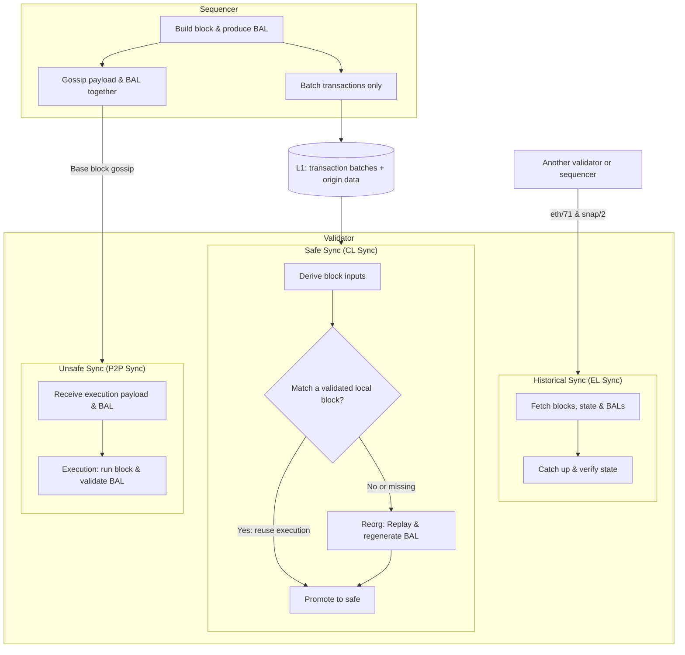

# Glamsterdam

## Contents

- [TODOs](#todos)
- [EIPs](#eips)
  - [Modified](#modified)
  - [Include As Is](#include-as-is)
- [Design](#design)
  - [Block-level access lists (EIP-7928)](#block-level-access-lists-eip-7928)
  - [Slot number (EIP-7843)](#slot-number-eip-7843)
  - [Calldata floor (EIP-7976)](#calldata-floor-eip-7976)
  - [Access-list pricing (EIP-7981)](#access-list-pricing-eip-7981)
- [Not included](#not-included)
- [References](#references)

## TODOs

- [ ] **AA transactions (EIP-8430):** Define transaction pricing.
- [ ] **State creation (EIP-8037):** Choose Base's gas price per byte of new state.
- [ ] **State access (EIP-8038):** Choose Base's account/storage access and write prices.
- [ ] **BAL Bandwidth Analysis:** Compare payload sizes with and without BALs, before and after compression.

## EIPs

### Modified

| EIP | Summary | Change Summary |
|---|---|---|
| [7928](https://eips.ethereum.org/EIPS/eip-7928) · [Design](#block-level-access-lists-eip-7928) | **Block-Level Access Lists:** Records block state accesses and changes to support parallel execution and faster state processing. | Gossip BALs with Base blocks; omit them from L1 batches and regenerate them during CL sync. |
| [2780](https://eips.ethereum.org/EIPS/eip-2780) | **Resource-based intrinsic transaction gas:** Replaces flat transaction overhead with charges for the resources actually consumed. | Extend the gas model to AA transactions (EIP-8430), including batching, sponsorship, and nonce modes. |
| [7843](https://eips.ethereum.org/EIPS/eip-7843) · [Design](#slot-number-eip-7843) | **SLOTNUM opcode:** Exposes the current consensus slot through a new opcode and block-header field. | Use the L2 block number as the slot, rather than Ethereum's beacon slot. |
| [7976](https://eips.ethereum.org/EIPS/eip-7976) · [Design](#calldata-floor-eip-7976) | **Increase Calldata Floor Cost:** Raises the transaction calldata floor to 64 gas per byte. | Recommend 128 gas/byte instead of L1's 64 to reduce block sizes and calldata growth. |
| [8037](https://eips.ethereum.org/EIPS/eip-8037) | **State Creation Gas Cost Increase:** Reprices new state and meters state creation separately from execution. | Tune the state-byte price for Base; value TBD. |
| [8038](https://eips.ethereum.org/EIPS/eip-8038) | **State-access gas cost update:** Revises charges for account and storage accesses and writes. | Tune account/storage access and write prices for Base; values TBD. |
| [7981](https://eips.ethereum.org/EIPS/eip-7981) · [Design](#access-list-pricing-eip-7981) | **Increase Access List Cost:** Charges transaction access lists for their data footprint. | Match EIP-7976's calldata floor: 128 gas/byte. |

### Include As Is

| EIP | Summary | Change Summary |
|---|---|---|
| [7708](https://eips.ethereum.org/EIPS/eip-7708) | **ETH transfers emit a log:** Adds protocol-generated logs for native ETH transfers. | Same as L1. |
| [7778](https://eips.ethereum.org/EIPS/eip-7778) | **Block Gas Accounting without Refunds:** Counts pre-refund execution work against block capacity while retaining user refunds. | Same as L1. |
| [7954](https://eips.ethereum.org/EIPS/eip-7954) | **Increase Maximum Contract Size:** Raises deployed-code and initcode limits to 64 KiB and 128 KiB respectively. | Same as L1. |
| [7997](https://eips.ethereum.org/EIPS/eip-7997) | **Deterministic Factory Contract:** Requires the standard `CREATE2` factory at a common address across EVM chains. | Same as L1. |
| [8024](https://eips.ethereum.org/EIPS/eip-8024) | **Backward compatible SWAPN, DUPN, EXCHANGE:** Adds instructions for accessing and rearranging deeper stack items. | Same as L1. |
| [8246](https://eips.ethereum.org/EIPS/eip-8246) | **Remove SELFDESTRUCT Burn:** Preserves remaining ETH balances when eligible self-destructed accounts are cleared. | Same as L1. |
| [7975](https://eips.ethereum.org/EIPS/eip-7975) | **eth/70—partial block receipt lists** (networking): Allows large receipt lists to be transferred in parts. | Same as L1. |
| [8159](https://eips.ethereum.org/EIPS/eip-8159) | **eth/71—Block Access List Exchange** (networking): Adds peer requests and responses for block access lists. | Same as L1. |
| [8189](https://eips.ethereum.org/EIPS/eip-8189) | **snap/2—BAL-Based State Healing** (networking): Uses block access lists to advance and repair downloaded state during synchronization. | Same as L1. |

## Design

### Block-level access lists (EIP-7928)

#### Goals

- **Fast Validator Sync (Tip and Historical)**
- **Minimize L1 Blob Requirements**

#### Architecture

#### Differences from L1

- **Gossip:** Include the BAL in the gossiped block's execution payload, not as a separate sidecar, so validators receive the block and BAL together without another fetch.
  - **Higher node bandwidth:** Validators are expected to run on high-bandwidth data-center connections, so extra peer traffic is an acceptable cost for avoiding a separate BAL fetch.
- **L1 blobs:** Publish transaction batches only. BALs can be regenerated from execution, including L1-derived deposits and system inputs.
  - **Slower CL sync:** Historical catch-up uses EL sync, and CL reconciliation should match already validated blocks without re-execution in normal operation. Accepting slower replay during exceptional recovery avoids paying L1 blob costs for BALs on every block.

### Slot number (EIP-7843)

| Option | Pros | Cons | Use cases |
|---|---|---|---|
| **L2 block number (recommended)** | Simple to validate. Every Base block has a distinct slot. Leaves room for a future Base slot counter that advances across skipped blocks. | Already available via `NUMBER` today. | Schedule local execution or track recent state by L2 block. |
| **L1 origin's beacon slot** | Follows OP's L1 consensus-data precedent (e.g. [EIP-4399](https://docs.base.org/specifications/base-protocol/execution/l2-execution-engine), [EIP-4788](https://docs.base.org/specifications/base-protocol/execution/l2-execution-engine)). | Multiple L2 blocks share a slot. Advances only with the L1 origin. | Align Ethereum oracle reporting periods or reference beacon-proof slots. |

### Calldata floor (EIP-7976)

`charged gas = max(txn cost, base_tx_cost + bytes * constant)`

**Recommendation: `constant = 128` gas/byte**, for both zero and nonzero bytes. This halves the calldata size and growth bounds compared with 64, without increasing costs in the sampled transaction comparison.

Priorities, in order:

1. **Transaction costs:** Avoid pricing out payments, swaps, and other common transactions.
2. **P2P block sizes:** Limit worst-case incompressible block sizes.
3. **Storage growth:** Keep yearly calldata growth manageable.

> **Note:** This is not the best mechanism to control L1 DA backlog: it prices raw calldata bytes without accounting for compression or available L1 DA capacity. More accurate L1 DA pricing should address that directly.

#### Transaction costs

| Transaction | Calldata bytes | Receipt gas |
|---|---|---|
| [USDC payment](https://basescan.org/tx/0x49c4bb7f80c94016db47bdf78e0654b8afa841622f78f8218a9f3b5d5871895c) | 68 | 40,271 |
| [Aerodrome Router swap](https://basescan.org/tx/0x2806baaddd14ea95cb8744183561efe9f2393347f4ed1e23396f51dba421efbf) | 324 | 181,916 |
| [Aerodrome Slipstream swap](https://basescan.org/tx/0x946ac8f533e9ebd1e1b75865e5a6c76673bd13170a4a73840f8c8e47c92d9c8a) | 260 | 186,366 |
| [Uniswap SwapRouter02 swap](https://basescan.org/tx/0x156a6324e1774e48d0437d714cec335fb3cfc35dc778a996ddb5e184486dbf17) | 228 | 105,413 |
| [Uniswap Universal Router swap](https://basescan.org/tx/0xab715150858242b67afb854b7eb6421dde55d5239893ebdbbfea97636d23a34f) | 644 | 171,148 |

| Constant (gas/byte) | USDC payment | Aerodrome Router | Slipstream | Uniswap Router02 | Universal Router |
|---|---|---|---|---|---|
| 64 | 40,271 | 181,916 | 186,366 | 105,413 | 171,148 |
| 🟩 **128** | 40,271 | 181,916 | 186,366 | 105,413 | 171,148 |
| 256 | 40,271 | 181,916 | 186,366 | 105,413 | **185,864** |
| 512 | **49,816** | 181,916 | 186,366 | **137,736** | **350,728** |
| 1,024 | **84,632** | **346,776** | **281,240** | **254,472** | **680,456** |

#### P2P block sizes and storage growth

##### Today: 400M gas/block · 2-second blocks

| Price per byte | Max calldata/block | Yearly growth | Gas to fill 10 MiB |
|---|---|---|---|
| [Zero bytes](https://eips.ethereum.org/EIPS/eip-7623) — 10 gas | 40 MB | 105.12 TB | ~105M |
| Blended — 30 gas | 13.33 MB | 35.04 TB | ~315M |
| [Nonzero bytes](https://eips.ethereum.org/EIPS/eip-7623) — 40 gas | 10 MB | 26.28 TB | ~419M |

##### Denim: 40M gas/block · 200 ms blocks

| Price per byte | Max calldata/block | Yearly growth | Gas to fill 10 MiB |
|---|---|---|---|
| [Zero bytes](https://eips.ethereum.org/EIPS/eip-7623) — 10 gas | 4 MB | 105.12 TB | ~105M |
| Blended — 30 gas | 1.33 MB | 35.04 TB | ~315M |
| [Nonzero bytes](https://eips.ethereum.org/EIPS/eip-7623) — 40 gas | 1 MB | 26.28 TB | ~419M |

##### 200M gas/s limit · 33.33M gas/s target

| Price per byte | Max calldata/block | Yearly growth | Gas to fill 10 MiB |
|---|---|---|---|
| 64 gas | 625 kB | 16.43 TB | ~671M |
| 🟩 **128 gas** | **312.5 kB** | **8.21 TB** | **~1.34B** |
| 256 gas | 156.25 kB | 4.11 TB | ~2.68B |
| 512 gas | 78.13 kB | 2.05 TB | ~5.37B |

##### 1G gas/s limit · 166.67M gas/s target

| Price per byte | Max calldata/block | Yearly growth | Gas to fill 10 MiB |
|---|---|---|---|
| 64 gas | 3.13 MB | 82.13 TB | ~671M |
| 🟩 **128 gas** | **1.56 MB** | **41.06 TB** | **~1.34B** |
| 256 gas | 781.25 kB | 20.53 TB | ~2.68B |
| 512 gas | 390.63 kB | 10.27 TB | ~5.37B |

### Access-list pricing (EIP-7981)

Access-list data pricing must match the [EIP-7976 calldata floor](#calldata-floor-eip-7976): **128 gas/byte**. Access lists also consume block space, so matching the rate prevents them from becoming a cheaper way to include data.

| Entry | Bytes | L1 data surcharge (64 gas/byte) | Base data surcharge (128 gas/byte) |
|---|---|---|---|
| Address | 20 | 1,280 gas | 2,560 gas |
| Storage key | 32 | 2,048 gas | 4,096 gas |

## Not included

| EIP | Summary | Relevant |
|---|---|---|
| [7688](https://eips.ethereum.org/EIPS/eip-7688) | **Forward compatible consensus data structures:** Makes Ethereum consensus structures easier to extend without breaking existing proofs. | Changes Ethereum beacon-chain structures rather than Base's L2 execution rules. |
| [7732](https://eips.ethereum.org/EIPS/eip-7732) | **Enshrined Proposer-Builder Separation:** Moves proposer/builder separation into Ethereum's consensus protocol. | Base's sequencing architecture does not use Ethereum's beacon proposer/builder mechanism. |
| [8045](https://eips.ethereum.org/EIPS/eip-8045) | **Exclude slashed validators from proposing:** Prevents slashed Ethereum validators from being selected as proposers. | Base does not use Ethereum's validator proposer-selection rules for L2 blocks. |
| [8061](https://eips.ethereum.org/EIPS/eip-8061) | **Increase exit and consolidation churn:** Increases Ethereum validator exit and consolidation capacity. | Ethereum staking queues are outside Base's L2 protocol. |
| [8282](https://eips.ethereum.org/EIPS/eip-8282) | **Builder Execution Requests:** Adds contracts and execution requests for ePBS builder deposits and exits. | These manage Ethereum's staked ePBS builders, which Base's L2 sequencing does not use. |
| [8070](https://eips.ethereum.org/EIPS/eip-8070) | **eth/72—Sparse Blobpool** (networking): Lets peers exchange selected blob cells instead of always retaining full blob sidecars. | Applies to Ethereum's blob pool; Base publishes blobs on L1 rather than supporting an equivalent L2 blob pool. |
| [8136](https://eips.ethereum.org/EIPS/eip-8136) | **Cell-Level Deltas for Data Column Broadcast** (networking): Avoids retransmitting blob cells peers already possess. | Applies to Ethereum PeerDAS networking, with indirect benefits to Base's L1 data availability. |
| [7904](https://eips.ethereum.org/EIPS/eip-7904) | **Compute Gas Cost Analysis** (informational): Reports benchmarks concluding that no compute gas repricing is required at the studied throughput. | Specifies no protocol change for Base to adopt. |
| [8261](https://eips.ethereum.org/EIPS/eip-8261) | **Gas Limit Schedule** (informational): Recommends epoch-based gas-limit defaults in Ethereum consensus-client configuration. | Base controls its L2 gas limit separately from Ethereum validator preferences. |

## References

- [Glamsterdam meta-EIP (EIP-7773)](https://eips.ethereum.org/EIPS/eip-7773)
- [Resource-based transaction gas (EIP-2780)](https://eips.ethereum.org/EIPS/eip-2780)
- [Calldata floor specification (EIP-7976)](https://eips.ethereum.org/EIPS/eip-7976)
- [Access-list data pricing (EIP-7981)](https://eips.ethereum.org/EIPS/eip-7981)
- [Base gas limits, block time, and fee parameters](https://docs.base.org/specifications/transactions/throughput-and-limits)
- [AA Transaction Type (EIP-8430)](https://github.com/chunter-cb/EIPs/blob/aa-transaction-type/EIPS/eip-8430.md), split out of [EIP-8130](https://eips.ethereum.org/EIPS/eip-8130); Base's `eip8130` crates implement it under the pre-split name
- [State creation and gas reservoirs (EIP-8037)](https://eips.ethereum.org/EIPS/eip-8037)
- [Account and storage access pricing (EIP-8038)](https://eips.ethereum.org/EIPS/eip-8038)
- [SLOTNUM specification (EIP-7843)](https://eips.ethereum.org/EIPS/eip-7843)
- [SLOTNUM use-case discussion](https://ethereum-magicians.org/t/eip-7843-slotnum-opcode/22234)
- [OP Stack L1 consensus context: PREVRANDAO and beacon roots](https://docs.base.org/specifications/base-protocol/execution/l2-execution-engine)
- [Conditional Transactions (EIP-7793, stagnant)](https://eips.ethereum.org/EIPS/eip-7793)
- [Recent Roots for Frame Transactions (EIP-8272, draft)](https://eips.ethereum.org/EIPS/eip-8272)
- [Block-level access lists (EIP-7928)](https://eips.ethereum.org/EIPS/eip-7928)
- [BAL exchange over eth/71 (EIP-8159)](https://eips.ethereum.org/EIPS/eip-8159)
- [BAL-based state healing over snap/2 (EIP-8189)](https://eips.ethereum.org/EIPS/eip-8189)
- [Base L1 derivation and batch format](https://docs.base.org/specifications/base-protocol/consensus/derivation)
- [Base rollup-node P2P and block gossip specification](https://docs.base.org/specifications/base-protocol/consensus/p2p)
- [Reth v2.7.0 BAL storage and pruning](https://github.com/paradigmxyz/reth/blob/v2.7.0/crates/storage/provider/src/bal/rocksdb.rs)
- [Base's pinned Reth fork](https://github.com/base/reth/tree/base-v2.7.0.2)
- [Reth v2.7.0 release notes](https://github.com/paradigmxyz/reth/releases/tag/v2.7.0)
- [v2.7.0 source and pinned dependencies](https://github.com/paradigmxyz/reth/tree/v2.7.0)
- [revm's Amsterdam gas rules](https://docs.rs/revm-context-interface/43.0.2/src/revm_context_interface/cfg/gas_params.rs.html)
- [Reth networking implementations](https://github.com/paradigmxyz/reth/tree/v2.7.0/crates/net)
- [BAL-based synchronization](https://github.com/paradigmxyz/reth/tree/v2.7.0/crates/snap-sync)
